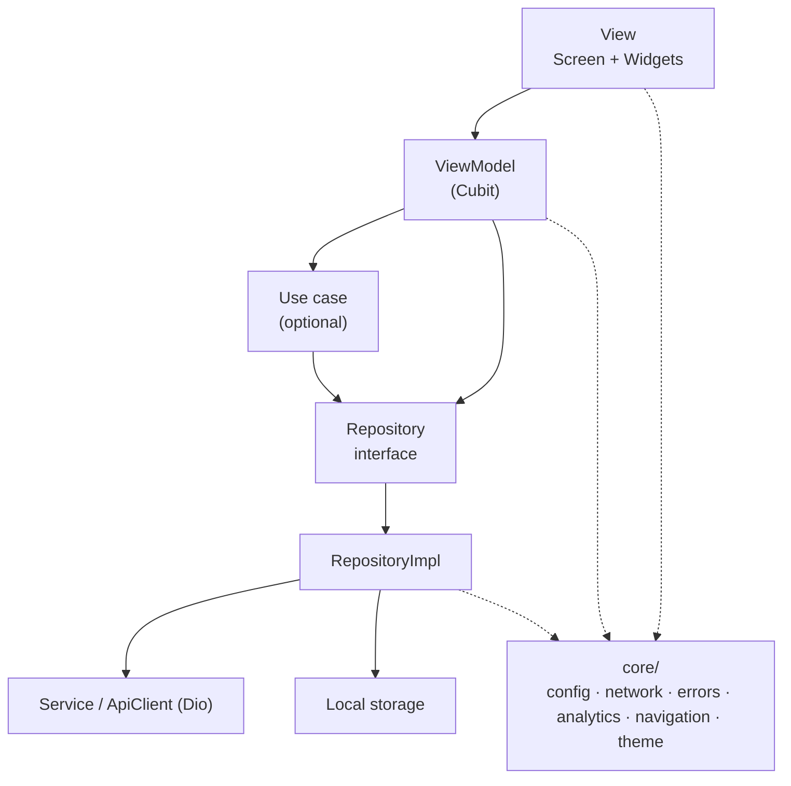

# 01 · Architecture

## Goal

Define the app's layers, where each file lives, how dependencies are created and delivered, and in what order the app initializes.

The foundation is the [official Flutter architecture guide](https://docs.flutter.dev/app-architecture/guide) (MVVM with a UI layer and a data layer, optional domain). Where this guide diverges, there is a **"Difference from the official guide"** block explaining why.

---

## Layers



| Layer | Responsibility | Must not |
|---|---|---|
| **View** (Screen, Widgets) | Draw the state, capture interaction, navigate and give visual feedback | Call repository/API; contain business rules |
| **ViewModel** (Cubit) | Turn app data into screen state; expose *commands* (public methods) | Import `material.dart`/widgets; receive `BuildContext`; navigate |
| **Use case** (optional) | Business rule that combines more than one repository or is reused by several ViewModels | Exist only to forward calls |
| **Repository** | Single source of truth for data: fetching, caching, retry, conversion into domain models | Expose `Response`, JSON or `DioException`; depend on another repository |
| **Service** | Wrap an external source (REST API, local database, plugin) without holding state | Know about the layers above |
| **Core** | Cross-cutting infrastructure | Import anything from `features/` |

### Unidirectional flow

Data flows up (`Service → Repository → ViewModel → View`) and events flow down (`View → ViewModel command → Repository`). The View never changes data directly; it calls a ViewModel method and redraws when the state changes.

### View and ViewModel relationship

Each screen (`OrdersScreen`) has **one** ViewModel (`OrdersCubit`). Smaller widgets on the screen receive data through parameters (see [03](03-componentization.md)).

### When to create a use case

Create one only if there is a **real rule**: a calculation, compound validation, or orchestration of two or more repositories. A use case that only does `return _repository.getX()` is a dead layer. In that case, the ViewModel talks directly to the repository.

---

## Folder structure

```
lib/
├── main.dart                       # single entrypoint (see 09-flavors-environments.md)
├── bootstrap.dart                  # initialization and dependency composition
├── app.dart                        # MaterialApp.router
│
├── core/                           # infrastructure, no business rules
│   ├── config/                     # AppConfig, environments
│   ├── network/                    # ApiClient, interceptors, safeCall
│   ├── errors/                     # Failure, ErrorHandlerMixin, CrashReporter
│   ├── analytics/                  # AnalyticsService
│   ├── navigation/                 # router, routes, AppNavigator
│   ├── push/                       # PushService, PushRouter
│   ├── storage/                    # preferences, secure storage
│   ├── theme/                      # theme and tokens (if there is no external design system)
│   └── utils/                      # extensions, formatters, validators
│
├── shared/                         # used by 2+ features
│   ├── data/                       # shared models, repositories and services
│   └── ui/                         # shared widgets (ErrorView, EmptyView...)
│
└── features/
    └── orders/
        ├── data/
        │   ├── models/             # order.dart, create_order_request.dart
        │   ├── repositories/       # orders_repository.dart (+ _impl)
        │   └── services/           # (optional) feature-specific service
        ├── domain/                 # (optional) use cases
        ├── analytics/              # orders_analytics.dart
        └── ui/
            ├── view_models/        # orders_cubit.dart, orders_state.dart
            └── widgets/            # orders_screen.dart, order_card.dart...

test/                               # mirrors lib/
testing/
└── fakes/                          # reusable fakes (FakeOrdersRepository...)
```

### Difference from the official guide

The [official case study](https://docs.flutter.dev/app-architecture/case-study) groups the data layer **by type** (`lib/data/repositories`, `lib/domain/models`) and only the UI by feature (`lib/ui/<feature>`). This guide keeps **the data inside the feature as well**, because:

- each feature is self-contained: you can understand, review or remove a piece of functionality by looking at a single folder;
- in apps with dozens of independent services (common in government apps and "super apps"), most repositories belong to a single feature, and a global `data/repositories` folder turns into a long list with no owner.

Whatever is used by more than one feature goes to `shared/data/`, reaching the same result as the official approach in those cases. Inside the feature, naming follows the official guide (`ui/view_models/`, `ui/widgets/`, `XxxScreen`).

### Rules

- ✅ Folders and files in `snake_case` (`school_lunch/`, never `schoolLunch/`).
- ✅ One name per concept: `view_models/`, `widgets/`, `models/`. Never `widget/`, `new_widgets/`, `views/` and `pages/` side by side.
- ✅ Classes named after their architectural role: `OrdersScreen`, `OrdersCubit`, `OrdersRepository`, `OrdersApiService`.
- ✅ Fixed file suffixes: `_screen.dart`, `_cubit.dart`, `_state.dart`, `_repository.dart`, `_repository_impl.dart`, `_service.dart`, `_analytics.dart`.
- ✅ A feature may import from `core/` and `shared/`. Never from another feature.
- ✅ Tests mirror `lib/` in `test/`; reusable fakes live in `testing/fakes/`.
- ❌ "Barrel" files (`exports.dart`) that re-export the whole feature. They hide dependencies and create cycles.
- ❌ A `helpers/` or `misc/` folder inside the feature. If it is a generic utility, it goes to `core/utils/`.

### When something goes to `shared/`

A model, repository or widget is born inside the feature. It is only moved to `shared/` when the **second** feature needs it. Moving it earlier is guessing.

If two features depend heavily on each other, they are probably the same feature, or a concept is missing in `shared/`.

---

## Dependency injection

We follow the official recommendation: [`provider`](https://docs.flutter.dev/app-architecture/case-study/dependency-injection), here through the widgets `flutter_bloc` already ships (`RepositoryProvider` and `MultiRepositoryProvider`, built on top of `provider`). There are no global objects and no service locator.

| What | Where it is created | How it reaches its consumers |
|---|---|---|
| Infrastructure (`AppConfig`, `ApiClient`, `CrashReporter`, `AnalyticsService`) | `bootstrap.dart`, as plain Dart objects | Through the constructor of whoever needs it and, if the UI needs it, exposed via `RepositoryProvider` |
| Repositories and services | `bootstrap.dart` | `MultiRepositoryProvider` at the top of the tree |
| ViewModels (Cubits) | In the route (`GoRoute.builder`), with `BlocProvider` | `context.read()` to fetch the repositories |
| Services without `BuildContext` (push, interceptors) | `bootstrap.dart` | Through the constructor, never through the widget tree |

### Rules

- ✅ Every dependency is received through the constructor and stored in a **private** `final` field (so the View, which sees the Cubit, does not call the repository directly).
- ✅ Repositories exposed by their **abstract type** (`RepositoryProvider<OrdersRepository>`), so the implementation can be swapped in tests or environments.
- ✅ `context.read()` only in composition: routes and providers' `create`.
- ✅ A new Cubit per screen (`BlocProvider(create: ...)`), closed automatically when the route leaves the stack.
- ❌ `static X get instance`, global variables or a service locator (`get_it`).
- ❌ `context.read<OrdersRepository>()` inside a Cubit, Repository or low-level widgets.

### Why

A class that fetches its own dependency (`UserService.instance`) cannot be tested with a fake without tricks. When it receives it through the constructor, the test just passes another implementation. `provider` solves the "who creates it" problem without global state, and it is already the foundation of `flutter_bloc`.

### Reference code

```dart
// lib/bootstrap.dart (composition)
Future<void> bootstrap(AppConfig config) async {
  WidgetsFlutterBinding.ensureInitialized();
  await Firebase.initializeApp(options: config.firebaseOptions);

  // Infrastructure: plain Dart objects, wired through the constructor
  final crashReporter = FirebaseCrashReporter()
    ..installGlobalHandlers(enabled: config.crashReportingEnabled);
  final analytics = config.analyticsEnabled
      ? FirebaseAnalyticsService()
      : const NoopAnalyticsService();
  final tokenStorage = SecureTokenStorage();
  final sessionEvents = SessionEvents();
  final apiClient = ApiClient(
    config: config,
    tokenStorage: tokenStorage,
    sessionEvents: sessionEvents,
  );

  // Repositories
  final sessionRepository = SessionRepositoryImpl(apiClient, tokenStorage);
  await sessionRepository.restore();
  final ordersRepository = OrdersRepositoryImpl(apiClient);

  // Global state and navigation
  final sessionCubit = SessionCubit(
    repository: sessionRepository,
    sessionEvents: sessionEvents,
    analytics: analytics,
    crashReporter: crashReporter,
  );
  final router = createRouter(session: sessionCubit, analytics: analytics);
  final pushService = PushService(
    router: PushRouter(navigator: AppNavigator(router), analytics: analytics),
    local: LocalNotifications(),
    tokenRepository: PushTokenRepositoryImpl(apiClient),
  );

  runApp(
    MultiRepositoryProvider(
      providers: [
        RepositoryProvider<AnalyticsService>.value(value: analytics),
        RepositoryProvider<CrashReporter>.value(value: crashReporter),
        RepositoryProvider<OrdersRepository>.value(value: ordersRepository),
      ],
      child: BlocProvider.value(
        value: sessionCubit,
        child: App(router: router),
      ),
    ),
  );

  WidgetsBinding.instance.addPostFrameCallback((_) => pushService.initialize());
}
```

```dart
// Cubit created in the route, fetching dependencies from the tree
GoRoute(
  path: AppPaths.orders,
  name: AppRoutes.orders,
  builder: (context, state) => BlocProvider(
    create: (context) => OrdersCubit(
      repository: context.read(),
      analytics: OrdersAnalytics(context.read()),
      crashReporter: context.read(),
    )..load(),
    child: const OrdersScreen(),
  ),
),
```

In projects with many features, split the composition into per-feature functions in the same file (`_ordersProviders(apiClient)` returning the list of `RepositoryProvider`). If `bootstrap.dart` grows past ~300 lines, move each function to `features/<feature>/<feature>_dependencies.dart`.

---

## Bootstrap

All initialization lives in `bootstrap.dart`. `main.dart` only discovers the environment and calls `bootstrap` (see [09](09-flavors-environments.md)).

### Order

1. `WidgetsFlutterBinding.ensureInitialized()`
2. Firebase (`Firebase.initializeApp` with the environment's options)
3. Global error handlers via `CrashReporter` (see [05](05-errors-crashlytics.md))
4. Composition: infrastructure, repositories, global state and router
5. Services that must be ready before the first screen (saved session, Remote Config with a short timeout)
6. `runApp`
7. After the first frame: push notifications, permissions and non-critical tasks

Everything that is not needed to draw the first screen goes to step 7. Every second in bootstrap is a second of splash screen.

---

## New feature checklist

- [ ] `features/<name>/` folder with `data/` and `ui/`
- [ ] Model(s) with strict `fromJson`/`toJson` ([04](04-networking.md))
- [ ] Repository (interface + impl) ([04](04-networking.md))
- [ ] State + Cubit in `ui/view_models/` with `ErrorHandlerMixin` ([02](02-state-management.md), [05](05-errors-crashlytics.md))
- [ ] Screen with loading/error/empty states ([03](03-componentization.md))
- [ ] Repository exposed in the `MultiRepositoryProvider` in `bootstrap.dart`
- [ ] Route in `core/navigation/` creating the Cubit ([07](07-navigation.md))
- [ ] Analytics events ([06](06-analytics.md))
- [ ] Repository fake in `testing/fakes/` and tests for the Cubit and the Repository ([02](02-state-management.md#testing))
