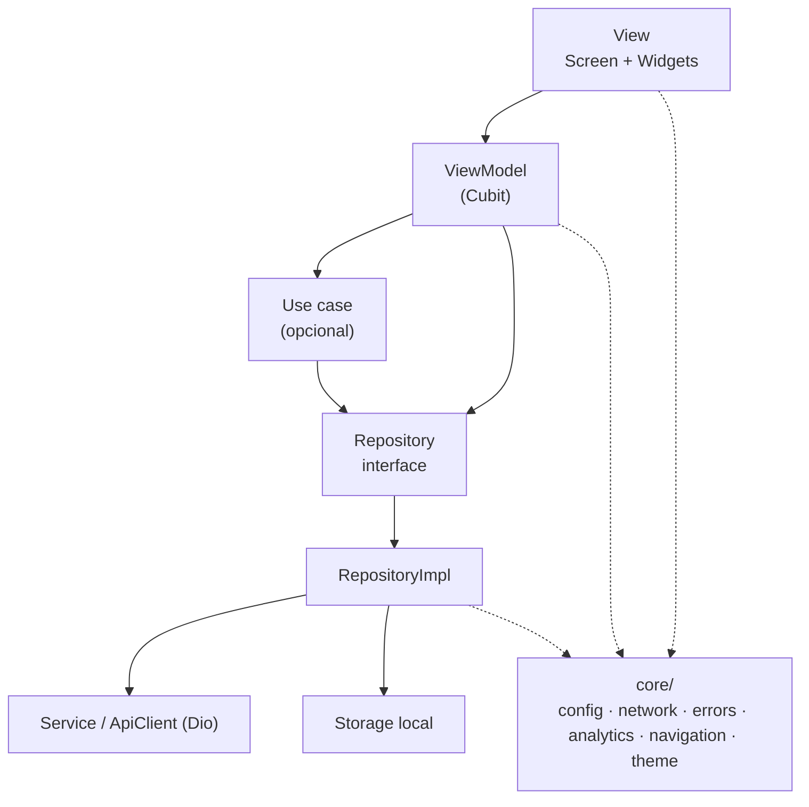

# 01 · Arquitetura

## Objetivo

Definir as camadas do app, onde cada arquivo mora, como as dependências são criadas e entregues, e em que ordem o app inicializa.

A base é o [guia oficial de arquitetura do Flutter](https://docs.flutter.dev/app-architecture/guide) (MVVM com camada de UI e camada de dados, domínio opcional). Onde este guia diverge, há um bloco **"Diferença em relação ao guia oficial"** explicando o motivo.

---

## Camadas



| Camada | Responsabilidade | Não pode |
|---|---|---|
| **View** (Screen, Widgets) | Desenhar o estado, capturar interação, navegar e dar feedback visual | Chamar repository/API; conter regra de negócio |
| **ViewModel** (Cubit) | Transformar dados do app em estado de tela; expor *commands* (métodos públicos) | Importar `material.dart`/widgets; receber `BuildContext`; navegar |
| **Use case** (opcional) | Regra de negócio que combina mais de um repository ou é reutilizada por vários ViewModels | Existir só para repassar chamadas |
| **Repository** | Fonte única da verdade dos dados: busca, cache, retry, conversão em model de domínio | Expor `Response`, JSON ou `DioException`; depender de outro repository |
| **Service** | Envolver uma fonte externa (API REST, banco local, plugin) sem guardar estado | Conhecer camadas acima |
| **Core** | Infraestrutura transversal | Importar qualquer coisa de `features/` |

### Fluxo unidirecional

Os dados sobem (`Service → Repository → ViewModel → View`) e os eventos descem (`View → command do ViewModel → Repository`). A View nunca altera dados diretamente; ela chama um método do ViewModel e redesenha quando o estado muda.

### Relação entre View e ViewModel

Cada tela (`OrdersScreen`) tem **um** ViewModel (`OrdersCubit`). Widgets menores da tela recebem dados por parâmetro (ver [03](03-componentizacao.md)).

### Quando criar um use case

Crie apenas se houver **regra real**: cálculo, validação composta, ou orquestração de dois ou mais repositories. Um use case que só faz `return _repository.getX()` é uma camada morta. Nesse caso, o ViewModel fala direto com o repository.

---

## Organização de pastas

```
lib/
├── main.dart                       # entrypoint único (ver 09-flavors-ambientes.md)
├── bootstrap.dart                  # inicialização e composição de dependências
├── app.dart                        # MaterialApp.router
│
├── core/                           # infraestrutura, sem regra de negócio
│   ├── config/                     # AppConfig, ambientes
│   ├── network/                    # ApiClient, interceptors, safeCall
│   ├── errors/                     # Failure, ErrorHandlerMixin, CrashReporter
│   ├── analytics/                  # AnalyticsService
│   ├── navigation/                 # router, rotas, AppNavigator
│   ├── push/                       # PushService, PushRouter
│   ├── storage/                    # preferências, armazenamento seguro
│   ├── theme/                      # tema e tokens (se não houver design system externo)
│   └── utils/                      # extensions, formatters, validators
│
├── shared/                         # usado por 2+ features
│   ├── data/                       # models, repositories e services compartilhados
│   └── ui/                         # widgets compartilhados (ErrorView, EmptyView...)
│
└── features/
    └── orders/
        ├── data/
        │   ├── models/             # order.dart, create_order_request.dart
        │   ├── repositories/       # orders_repository.dart (+ _impl)
        │   └── services/           # (opcional) service exclusivo da feature
        ├── domain/                 # (opcional) use cases
        ├── analytics/              # orders_analytics.dart
        └── ui/
            ├── view_models/        # orders_cubit.dart, orders_state.dart
            └── widgets/            # orders_screen.dart, order_card.dart...

test/                               # espelha lib/
testing/
└── fakes/                          # fakes reutilizáveis (FakeOrdersRepository...)
```

### Diferença em relação ao guia oficial

O [case study oficial](https://docs.flutter.dev/app-architecture/case-study) agrupa a camada de dados **por tipo** (`lib/data/repositories`, `lib/domain/models`) e só a UI por feature (`lib/ui/<feature>`). Este guia mantém **também os dados dentro da feature**, porque:

- cada feature fica autocontida: dá para entender, revisar ou remover uma funcionalidade olhando uma pasta só;
- em apps com dezenas de serviços independentes (comum em apps de governo e "super apps"), a maioria dos repositories pertence a uma única feature, e uma pasta `data/repositories` global vira uma lista longa sem dono.

O que é usado por mais de uma feature vai para `shared/data/`, chegando ao mesmo resultado do oficial nesses casos. Dentro da feature, a nomenclatura segue o oficial (`ui/view_models/`, `ui/widgets/`, `XxxScreen`).

### Regras

- ✅ Pastas e arquivos em `snake_case` (`school_lunch/`, nunca `schoolLunch/`).
- ✅ Um nome por conceito: `view_models/`, `widgets/`, `models/`. Nunca `widget/`, `new_widgets/`, `views/` e `pages/` convivendo.
- ✅ Classes nomeadas pelo papel na arquitetura: `OrdersScreen`, `OrdersCubit`, `OrdersRepository`, `OrdersApiService`.
- ✅ Sufixos fixos de arquivo: `_screen.dart`, `_cubit.dart`, `_state.dart`, `_repository.dart`, `_repository_impl.dart`, `_service.dart`, `_analytics.dart`.
- ✅ Uma feature pode importar de `core/` e `shared/`. Nunca de outra feature.
- ✅ Testes espelham `lib/` em `test/`; fakes reutilizáveis ficam em `testing/fakes/`.
- ❌ Arquivos "barril" (`exports.dart`) que reexportam a feature inteira. Eles escondem dependências e geram ciclos.
- ❌ Pasta `helpers/` ou `misc/` dentro da feature. Se é utilitário genérico, vai para `core/utils/`.

### Quando algo vai para `shared/`

Um model, repository ou widget nasce dentro da feature. Ele só é movido para `shared/` quando a **segunda** feature precisar dele. Mover antes é adivinhar.

Se duas features dependem muito uma da outra, provavelmente são a mesma feature ou falta um conceito em `shared/`.

---

## Injeção de dependência

Seguimos a recomendação oficial: [`provider`](https://docs.flutter.dev/app-architecture/case-study/dependency-injection), aqui pelos widgets que o `flutter_bloc` já traz (`RepositoryProvider` e `MultiRepositoryProvider`, construídos sobre o `provider`). Não há objetos globais nem service locator.

| O quê | Onde é criado | Como chega a quem usa |
|---|---|---|
| Infraestrutura (`AppConfig`, `ApiClient`, `CrashReporter`, `AnalyticsService`) | `bootstrap.dart`, como objetos Dart comuns | Pelo construtor de quem precisa e, se a UI precisar, exposto via `RepositoryProvider` |
| Repositories e services | `bootstrap.dart` | `MultiRepositoryProvider` no topo da árvore |
| ViewModels (Cubits) | Na rota (`GoRoute.builder`), com `BlocProvider` | `context.read()` para buscar os repositories |
| Serviços sem `BuildContext` (push, interceptors) | `bootstrap.dart` | Pelo construtor, nunca pela árvore de widgets |

### Regras

- ✅ Toda dependência é recebida pelo construtor e guardada em campo **privado** `final` (assim a View, que enxerga o Cubit, não chama o repository direto).
- ✅ Repositories expostos pelo **tipo abstrato** (`RepositoryProvider<OrdersRepository>`), para trocar a implementação em testes ou ambientes.
- ✅ `context.read()` só na composição: rotas e `create` de providers.
- ✅ Um Cubit novo por tela (`BlocProvider(create: ...)`), fechado automaticamente quando a rota sai da pilha.
- ❌ `static X get instance`, variáveis globais ou service locator (`get_it`).
- ❌ `context.read<OrdersRepository>()` dentro de Cubit, Repository ou widgets de baixo nível.

### Por quê

Uma classe que busca a própria dependência (`UserService.instance`) não pode ser testada com um fake sem truques. Recebendo pelo construtor, o teste só passa outra implementação. O `provider` resolve o problema de "quem cria" sem estado global, e já é a base do `flutter_bloc`.

### Código de referência

```dart
// lib/bootstrap.dart (composição)
Future<void> bootstrap(AppConfig config) async {
  WidgetsFlutterBinding.ensureInitialized();
  await Firebase.initializeApp(options: config.firebaseOptions);

  // Infraestrutura: objetos Dart comuns, ligados pelo construtor
  final crashReporter = FirebaseCrashReporter()
    ..installGlobalHandlers(enabled: config.crashReportingEnabled);
  final analytics = config.analyticsEnabled
      ? FirebaseAnalyticsService()
      : const NoopAnalyticsService();
  final tokenStorage = SecureTokenStorage();
  final sessionEvents = SessionEvents();
  final apiClient = ApiClient(
    config: config,
    tokenStorage: tokenStorage,
    sessionEvents: sessionEvents,
  );

  // Repositories
  final sessionRepository = SessionRepositoryImpl(apiClient, tokenStorage);
  await sessionRepository.restore();
  final ordersRepository = OrdersRepositoryImpl(apiClient);

  // Estado global e navegação
  final sessionCubit = SessionCubit(
    repository: sessionRepository,
    sessionEvents: sessionEvents,
    analytics: analytics,
    crashReporter: crashReporter,
  );
  final router = createRouter(session: sessionCubit, analytics: analytics);
  final pushService = PushService(
    router: PushRouter(navigator: AppNavigator(router), analytics: analytics),
    local: LocalNotifications(),
    tokenRepository: PushTokenRepositoryImpl(apiClient),
  );

  runApp(
    MultiRepositoryProvider(
      providers: [
        RepositoryProvider<AnalyticsService>.value(value: analytics),
        RepositoryProvider<CrashReporter>.value(value: crashReporter),
        RepositoryProvider<OrdersRepository>.value(value: ordersRepository),
      ],
      child: BlocProvider.value(
        value: sessionCubit,
        child: App(router: router),
      ),
    ),
  );

  WidgetsBinding.instance.addPostFrameCallback((_) => pushService.initialize());
}
```

```dart
// Cubit criado na rota, buscando dependências na árvore
GoRoute(
  path: AppPaths.orders,
  name: AppRoutes.orders,
  builder: (context, state) => BlocProvider(
    create: (context) => OrdersCubit(
      repository: context.read(),
      analytics: OrdersAnalytics(context.read()),
      crashReporter: context.read(),
    )..load(),
    child: const OrdersScreen(),
  ),
),
```

Em projetos com muitas features, quebre a composição em funções por feature no mesmo arquivo (`_ordersProviders(apiClient)` retornando a lista de `RepositoryProvider`). Se o `bootstrap.dart` passar de ~300 linhas, mova cada função para `features/<feature>/<feature>_dependencies.dart`.

---

## Bootstrap

Toda a inicialização mora em `bootstrap.dart`. O `main.dart` só descobre o ambiente e chama `bootstrap` (ver [09](09-flavors-ambientes.md)).

### Ordem

1. `WidgetsFlutterBinding.ensureInitialized()`
2. Firebase (`Firebase.initializeApp` com as options do ambiente)
3. Handlers globais de erro via `CrashReporter` (ver [05](05-erros-crashlytics.md))
4. Composição: infraestrutura, repositories, estado global e router
5. Serviços que precisam estar prontos antes da primeira tela (sessão salva, Remote Config com timeout curto)
6. `runApp`
7. Depois do primeiro frame: push notifications, permissões e tarefas não críticas

Tudo o que não é necessário para desenhar a primeira tela vai para o passo 7. Cada segundo no bootstrap é um segundo de splash.

---

## Checklist de nova feature

- [ ] Pasta `features/<nome>/` com `data/` e `ui/`
- [ ] Model(s) com `fromJson`/`toJson` estritos ([04](04-requests-rede.md))
- [ ] Repository (interface + impl) ([04](04-requests-rede.md))
- [ ] State + Cubit em `ui/view_models/` com `ErrorHandlerMixin` ([02](02-gerenciamento-estado.md), [05](05-erros-crashlytics.md))
- [ ] Screen com estados de loading/erro/vazio ([03](03-componentizacao.md))
- [ ] Repository exposto no `MultiRepositoryProvider` do `bootstrap.dart`
- [ ] Rota em `core/navigation/` criando o Cubit ([07](07-navegacao.md))
- [ ] Eventos de analytics ([06](06-analytics.md))
- [ ] Fake do repository em `testing/fakes/` e testes do Cubit e do Repository ([02](02-gerenciamento-estado.md#testando))
