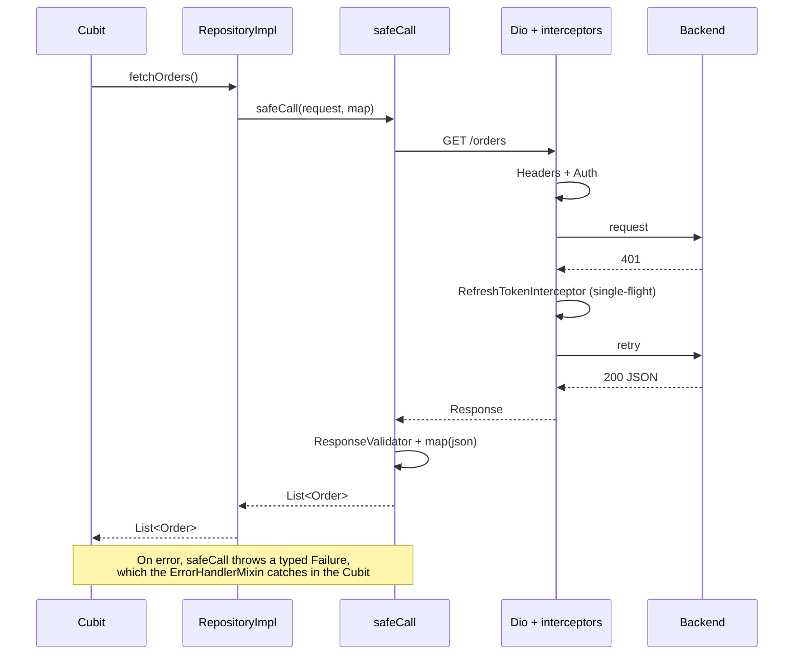

# 04 · Requests and networking

## Goal

Standardize how the app talks to APIs: one HTTP client configured in a single place, interceptors with one responsibility each, conversion of errors into `Failure`, and repositories that return domain models.

---

## Request flow



---

## ApiClient

In the official vocabulary, `ApiClient` is a **service**: it wraps the REST API and holds no business state. It is a `Dio` configured from `AppConfig`. If the app talks to more than one backend, create one class per backend (`PaymentsApiClient`), so each repository receives the right type through its constructor.

```dart
// lib/core/network/api_client.dart
class ApiClient {
  ApiClient({
    required AppConfig config,
    required TokenStorage tokenStorage,
    required SessionEvents sessionEvents,
    ResponseValidator? responseValidator,
  })  : responseValidator = responseValidator ?? const DefaultResponseValidator(),
        dio = Dio(
          BaseOptions(
            baseUrl: config.apiBaseUrl,
            connectTimeout: const Duration(seconds: 15),
            receiveTimeout: const Duration(seconds: 30),
            sendTimeout: const Duration(seconds: 30),
            contentType: Headers.jsonContentType,
          ),
        ) {
    dio.interceptors.addAll([
      HeadersInterceptor(config),
      AuthInterceptor(tokenStorage),
      RefreshTokenInterceptor(
        // "Clean" Dio, without this interceptor: avoids a deadlock in the QueuedInterceptor queue
        plainDio: Dio(BaseOptions(baseUrl: config.apiBaseUrl)),
        tokenStorage: tokenStorage,
        sessionEvents: sessionEvents,
      ),
      if (config.enableHttpLogs)
        LogInterceptor(requestBody: true, responseBody: true),
    ]);
  }

  final Dio dio;
  final ResponseValidator responseValidator;
}
```

### Rules

- ✅ Base URL and timeouts come from `AppConfig`, never from a loose string in the repository.
- ✅ Specific timeouts (file upload, heavy report) via `Options(receiveTimeout: ...)` on the call itself.
- ✅ `LogInterceptor` only when `enableHttpLogs` (off in production).
- ❌ Creating `Dio()` inside a repository or Cubit.
- ❌ `HttpOverrides` that accept any certificate. If the backend uses its own CA, add only that CA to the `SecurityContext`.

---

## Interceptors

Each interceptor does exactly one thing.

| Interceptor | Responsibility |
|---|---|
| `HeadersInterceptor` | Fixed headers: app version, platform, device id, `Accept-Language` |
| `AuthInterceptor` | Add `Authorization: Bearer <token>` when there is a session |
| `RefreshTokenInterceptor` | On 401: renew the token **once** (even with N requests failing together), retry the request and, if that fails, signal that the session expired |
| `LogInterceptor` | Logging in development |

```dart
// lib/core/network/interceptors/refresh_token_interceptor.dart
class RefreshTokenInterceptor extends QueuedInterceptor {
  RefreshTokenInterceptor({
    required this.plainDio,
    required this.tokenStorage,
    required this.sessionEvents,
  });

  /// Used for the refresh and the retry. It must not have this interceptor: if the retry
  /// fails inside the QueuedInterceptor queue, the queue hangs waiting on itself.
  final Dio plainDio;
  final TokenStorage tokenStorage;
  final SessionEvents sessionEvents;

  static const _retriedKey = 'auth_retried';

  @override
  Future<void> onError(
    DioException err,
    ErrorInterceptorHandler handler,
  ) async {
    final isUnauthorized = err.response?.statusCode == 401;
    final alreadyRetried = err.requestOptions.extra[_retriedKey] == true;
    final isRefreshCall = err.requestOptions.path.endsWith('/auth/refresh');

    if (!isUnauthorized || alreadyRetried || isRefreshCall) {
      return handler.next(err);
    }

    // QueuedInterceptor processes one error at a time: requests that fail
    // while the refresh runs wait and then find the new token already in place.
    final refreshed = await _refreshIfNeeded(err.requestOptions);
    if (!refreshed) {
      sessionEvents.emitExpired();
      return handler.next(err);
    }

    try {
      final options = err.requestOptions..extra[_retriedKey] = true;
      options.headers['Authorization'] = 'Bearer ${await tokenStorage.accessToken}';
      handler.resolve(await plainDio.fetch(options));
    } on DioException catch (e) {
      handler.next(e);
    }
  }

  Future<bool> _refreshIfNeeded(RequestOptions failed) async {
    final current = await tokenStorage.accessToken;
    final usedToken = failed.headers['Authorization'];
    // Another request already renewed the token while this one waited in the queue
    if (current != null && usedToken != 'Bearer $current') return true;

    final refreshToken = await tokenStorage.refreshToken;
    if (refreshToken == null) return false;

    try {
      final response = await plainDio.post(
        '/auth/refresh',
        data: {'refreshToken': refreshToken},
      );
      await tokenStorage.save(
        accessToken: response.data['accessToken'] as String,
        refreshToken: response.data['refreshToken'] as String,
      );
      return true;
    } catch (_) {
      await tokenStorage.clear();
      return false;
    }
  }
}
```

### Expired session

The interceptor **does not navigate and does not log out**. It only emits an event:

```dart
// lib/core/network/session_events.dart
class SessionEvents {
  final _controller = StreamController<void>.broadcast();
  Stream<void> get onExpired => _controller.stream;
  void emitExpired() => _controller.add(null);
}
```

The listener is `SessionCubit` (global state), which clears the session. The router's `redirect` reacts and takes the user to login (see [07](07-navigation.md)). This way the network layer still knows nothing about UI or routes.

---

## safeCall

An extension that runs the request, validates the response, applies `map` and converts **any** error into a `Failure`.

```dart
// lib/core/network/safe_call.dart
extension SafeCall on ApiClient {
  Future<T> safeCall<T>(
    Future<Response<dynamic>> Function(Dio dio) request,
    FutureOr<T> Function(dynamic data) map,
  ) async {
    try {
      final response = await request(dio);
      responseValidator.validate(response); // throws Failure if the body indicates an error
      return await map(response.data);
    } on Failure {
      rethrow;
    } on DioException catch (e, s) {
      throw FailureMapper.fromDio(e, s);
    } on FormatException catch (e, s) {
      throw UnexpectedFailure(cause: e, stackTrace: s, debugMessage: 'Invalid JSON');
    } on TypeError catch (e, s) {
      throw UnexpectedFailure(cause: e, stackTrace: s, debugMessage: 'JSON contract changed');
    } catch (e, s) {
      throw UnexpectedFailure(cause: e, stackTrace: s);
    }
  }
}
```

### ResponseValidator

Some backends respond `200` with an error in the body (`{"success": false, "messages": [...]}`). This quirk does **not** go into `safeCall`: it goes into a validator injected into `ApiClient`.

```dart
abstract interface class ResponseValidator {
  void validate(Response<dynamic> response);
}

class DefaultResponseValidator implements ResponseValidator {
  const DefaultResponseValidator();
  @override
  void validate(Response<dynamic> response) {}
}

/// Example for a backend that uses a { success, messages, data } envelope
class EnvelopeResponseValidator implements ResponseValidator {
  const EnvelopeResponseValidator();

  @override
  void validate(Response<dynamic> response) {
    final data = response.data;
    if (data is Map<String, dynamic> && data['success'] == false) {
      final messages = (data['messages'] as List?)?.whereType<String>().join('. ');
      throw ServerFailure(
        statusCode: response.statusCode,
        backendMessage: messages,
      );
    }
  }
}
```

### Rules

- ✅ Every HTTP access goes through `safeCall`.
- ✅ `safeCall` only converts errors. The Cubit is the one that records to Crashlytics (see [05](05-errors-crashlytics.md)), so each error is reported exactly once.
- ❌ Business rules, navigation or logout inside `safeCall`.
- ❌ `throw Exception('message')`. Always a subclass of `Failure`.

### Difference from the official guide

The [official guide](https://docs.flutter.dev/app-architecture/design-patterns/result) recommends that services and repositories **return** `Result<T>` (`Ok`/`Error`) instead of throwing exceptions. This guide keeps the model of **throwing `Failure`** and catching it in the Cubit's `ErrorHandlerMixin` (see [05](05-errors-crashlytics.md)), because:

- the problem `Result` solves (a forgotten exception crossing layers until it crashes the app) is covered by a single rule: every Cubit command goes through `handle(...)`, which catches, types and reports;
- it avoids unwrapping `Result` in every intermediate layer (a repository that only forwards, a use case that combines calls);
- `Failure` is `sealed`, so handling in the UI stays exhaustive.

The cost is that the compiler does not enforce handling: code review must ensure that no command calls the repository outside `handle`.

---

## Repository

```dart
// features/orders/data/repositories/orders_repository.dart
abstract interface class OrdersRepository {
  Future<List<Order>> fetchOrders({int page = 1});
  Future<Order> fetchOrder(String id);
  Future<Order> createOrder(CreateOrderRequest request);
}
```

```dart
// features/orders/data/repositories/orders_repository_impl.dart
class OrdersRepositoryImpl implements OrdersRepository {
  OrdersRepositoryImpl(this._api);

  final ApiClient _api;

  static const _base = '/v1/orders';

  @override
  Future<List<Order>> fetchOrders({int page = 1}) => _api.safeCall(
        (dio) => dio.get(_base, queryParameters: {'page': page}),
        // Large lists: convert in another isolate so the UI does not freeze
        (data) => compute(Order.listFromJson, data),
      );

  @override
  Future<Order> fetchOrder(String id) => _api.safeCall(
        (dio) => dio.get('$_base/$id'),
        (data) => Order.fromJson(data as Map<String, dynamic>),
      );

  @override
  Future<Order> createOrder(CreateOrderRequest request) => _api.safeCall(
        (dio) => dio.post(_base, data: request.toJson()),
        (data) => Order.fromJson(data as Map<String, dynamic>),
      );
}
```

### Rules

- ✅ Interface + implementation. The Cubit depends on the interface; the test uses a mock of it.
- ✅ Paths as private constants of the repository, never in the UI or the Cubit.
- ✅ Returns a domain model (`Order`), never `Response`, `Map` or `DioException`.
- ✅ Caching, when it exists, lives in the repository (memory or storage), transparently to the Cubit.
- ❌ A repository that depends on another repository. If you need to combine them, use a domain service ([01](01-architecture.md)).

---

## Models

Manual, **strict** parsing, as the [official JSON serialization skill](https://github.com/flutter/agent-plugins/tree/main/skills/flutter-implement-json-serialization) recommends: required fields are validated with *pattern matching* and, if the contract is broken, parsing throws `FormatException`. No codegen, to keep the build fast and the mapping visible.

```dart
// features/orders/data/models/order.dart
final class Order extends Equatable {
  const Order({
    required this.id,
    required this.title,
    required this.status,
    required this.createdAt,
    this.total = 0,
    this.notes,
  });

  factory Order.fromJson(Map<String, dynamic> json) {
    return switch (json) {
      {
        'id': final String id,
        'title': final String title,
        'createdAt': final String createdAt,
      } =>
        Order(
          id: id,
          title: title,
          createdAt: DateTime.parse(createdAt),
          // Optional fields and enums: tolerant, with an explicit default value
          status: OrderStatus.fromApi(json['status'] as String?),
          total: (json['total'] as num?)?.toDouble() ?? 0,
          notes: json['notes'] as String?,
        ),
      // Do not include the JSON in the message: it may contain personal data
      _ => throw const FormatException('Order: JSON outside the contract'),
    };
  }

  /// Static function so it can be used with compute().
  static List<Order> listFromJson(dynamic data) => switch (data) {
        {'items': final List<dynamic> items} => [
            for (final item in items) Order.fromJson(item as Map<String, dynamic>),
          ],
        _ => throw const FormatException('Order list outside the contract'),
      };

  final String id;
  final String title;
  final OrderStatus status;
  final DateTime createdAt;
  final double total;
  final String? notes;

  Map<String, dynamic> toJson() => {
        'id': id,
        'title': title,
        'status': status.apiValue,
        'createdAt': createdAt.toIso8601String(),
        'total': total,
        if (notes != null) 'notes': notes,
      };

  @override
  List<Object?> get props => [id, title, status, createdAt, total, notes];
}

enum OrderStatus {
  open('OPEN'),
  done('DONE'),
  unknown('');

  const OrderStatus(this.apiValue);
  final String apiValue;

  static OrderStatus fromApi(String? value) =>
      values.firstWhere((s) => s.apiValue == value, orElse: () => unknown);
}
```

### Why strict

A tolerant parse that replaces a missing `id` with `''` or an invalid date with `DateTime.now()` hides the contract break: the screen shows wrong data and nobody finds out. In strict mode, the `FormatException` becomes an `UnexpectedFailure` in `safeCall`, the screen shows the error state and the problem shows up in Crashlytics.

### Background parsing

If converting the response takes longer than a frame (~16 ms), typically lists with hundreds of items, use `compute()` with a top-level or static function, as in `Order.listFromJson` above. Dio's default `BackgroundTransformer` already runs `jsonDecode` for large responses off the main thread; `compute()` covers the conversion into models.

### Rules

- ✅ Required fields validated by *pattern matching*; a broken contract throws `FormatException`.
- ✅ Tolerance only where the contract allows it: optional fields (`as String?` with an explicit default) and enums (`unknown`). The backend will add new statuses, and the app must not break.
- ✅ **Response** model (`Order`) separate from the **request** model (`CreateOrderRequest`, with `toJson` only).
- ✅ Dart names follow the app's convention (`createdAt`), even if the JSON uses another (`creation_date`). The mapping lives only in `fromJson`/`toJson`.
- ✅ Unit test for `fromJson`/`toJson` of each model, including a JSON outside the contract.
- ❌ Silent default value for a required field (`?? ''`, `?? DateTime.now()`).
- ❌ Display logic in the model (`String get formattedTotal`). Use extensions in the UI layer.
