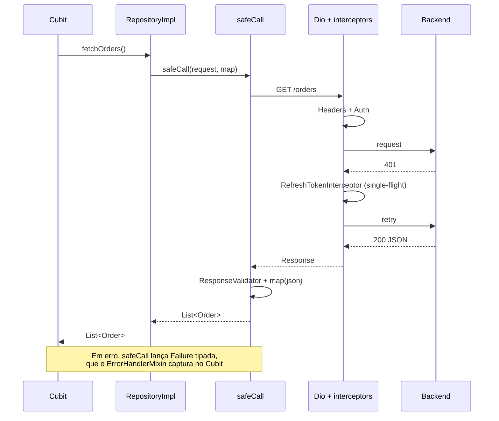

# 04 · Requests e rede

## Objetivo

Padronizar como o app fala com APIs: um cliente HTTP configurado em um único lugar, interceptors com uma responsabilidade cada, conversão de erros em `Failure` e repositories que devolvem modelos de domínio.

---

## Fluxo de uma requisição



---

## ApiClient

No vocabulário oficial, o `ApiClient` é um **service**: envolve a API REST e não guarda estado de negócio. É um `Dio` configurado a partir do `AppConfig`. Se o app fala com mais de um backend, crie uma classe por backend (`PaymentsApiClient`), para que cada repository receba o tipo certo pelo construtor.

```dart
// lib/core/network/api_client.dart
class ApiClient {
  ApiClient({
    required AppConfig config,
    required TokenStorage tokenStorage,
    required SessionEvents sessionEvents,
    ResponseValidator? responseValidator,
  })  : responseValidator = responseValidator ?? const DefaultResponseValidator(),
        dio = Dio(
          BaseOptions(
            baseUrl: config.apiBaseUrl,
            connectTimeout: const Duration(seconds: 15),
            receiveTimeout: const Duration(seconds: 30),
            sendTimeout: const Duration(seconds: 30),
            contentType: Headers.jsonContentType,
          ),
        ) {
    dio.interceptors.addAll([
      HeadersInterceptor(config),
      AuthInterceptor(tokenStorage),
      RefreshTokenInterceptor(
        // Dio "limpo", sem este interceptor: evita deadlock na fila do QueuedInterceptor
        plainDio: Dio(BaseOptions(baseUrl: config.apiBaseUrl)),
        tokenStorage: tokenStorage,
        sessionEvents: sessionEvents,
      ),
      if (config.enableHttpLogs)
        LogInterceptor(requestBody: true, responseBody: true),
    ]);
  }

  final Dio dio;
  final ResponseValidator responseValidator;
}
```

### Regras

- ✅ Base URL e timeouts vêm do `AppConfig`, nunca de string solta no repository.
- ✅ Timeouts específicos (upload de arquivo, relatório pesado) via `Options(receiveTimeout: ...)` na própria chamada.
- ✅ `LogInterceptor` só quando `enableHttpLogs` (desligado em produção).
- ❌ Criar `Dio()` dentro de repository ou Cubit.
- ❌ `HttpOverrides` que aceitam qualquer certificado. Se o backend usa uma CA própria, adicione apenas essa CA ao `SecurityContext`.

---

## Interceptors

Cada interceptor faz uma coisa só.

| Interceptor | Responsabilidade |
|---|---|
| `HeadersInterceptor` | Headers fixos: versão do app, plataforma, device id, `Accept-Language` |
| `AuthInterceptor` | Adicionar `Authorization: Bearer <token>` quando houver sessão |
| `RefreshTokenInterceptor` | Em 401: renovar o token **uma vez** (mesmo com N requisições falhando juntas), refazer a requisição e, se não der, avisar que a sessão expirou |
| `LogInterceptor` | Log em desenvolvimento |

```dart
// lib/core/network/interceptors/refresh_token_interceptor.dart
class RefreshTokenInterceptor extends QueuedInterceptor {
  RefreshTokenInterceptor({
    required this.plainDio,
    required this.tokenStorage,
    required this.sessionEvents,
  });

  /// Usado no refresh e no retry. Não pode ter este interceptor: se o retry
  /// falhar dentro da fila do QueuedInterceptor, a fila trava esperando a si mesma.
  final Dio plainDio;
  final TokenStorage tokenStorage;
  final SessionEvents sessionEvents;

  static const _retriedKey = 'auth_retried';

  @override
  Future<void> onError(
    DioException err,
    ErrorInterceptorHandler handler,
  ) async {
    final isUnauthorized = err.response?.statusCode == 401;
    final alreadyRetried = err.requestOptions.extra[_retriedKey] == true;
    final isRefreshCall = err.requestOptions.path.endsWith('/auth/refresh');

    if (!isUnauthorized || alreadyRetried || isRefreshCall) {
      return handler.next(err);
    }

    // QueuedInterceptor processa um erro por vez: as requisições que falharem
    // enquanto o refresh roda esperam e já encontram o token novo.
    final refreshed = await _refreshIfNeeded(err.requestOptions);
    if (!refreshed) {
      sessionEvents.emitExpired();
      return handler.next(err);
    }

    try {
      final options = err.requestOptions..extra[_retriedKey] = true;
      options.headers['Authorization'] = 'Bearer ${await tokenStorage.accessToken}';
      handler.resolve(await plainDio.fetch(options));
    } on DioException catch (e) {
      handler.next(e);
    }
  }

  Future<bool> _refreshIfNeeded(RequestOptions failed) async {
    final current = await tokenStorage.accessToken;
    final usedToken = failed.headers['Authorization'];
    // Outra requisição já renovou o token enquanto esta esperava na fila
    if (current != null && usedToken != 'Bearer $current') return true;

    final refreshToken = await tokenStorage.refreshToken;
    if (refreshToken == null) return false;

    try {
      final response = await plainDio.post(
        '/auth/refresh',
        data: {'refreshToken': refreshToken},
      );
      await tokenStorage.save(
        accessToken: response.data['accessToken'] as String,
        refreshToken: response.data['refreshToken'] as String,
      );
      return true;
    } catch (_) {
      await tokenStorage.clear();
      return false;
    }
  }
}
```

### Sessão expirada

O interceptor **não navega e não faz logout**. Ele só emite um evento:

```dart
// lib/core/network/session_events.dart
class SessionEvents {
  final _controller = StreamController<void>.broadcast();
  Stream<void> get onExpired => _controller.stream;
  void emitExpired() => _controller.add(null);
}
```

Quem escuta é o `SessionCubit` (estado global), que limpa a sessão. O `redirect` do router reage e leva para o login (ver [07](07-navegacao.md)). Assim a camada de rede continua sem conhecer UI nem rotas.

---

## safeCall

Extensão que executa a requisição, valida a resposta, aplica o `map` e converte **qualquer** erro em `Failure`.

```dart
// lib/core/network/safe_call.dart
extension SafeCall on ApiClient {
  Future<T> safeCall<T>(
    Future<Response<dynamic>> Function(Dio dio) request,
    FutureOr<T> Function(dynamic data) map,
  ) async {
    try {
      final response = await request(dio);
      responseValidator.validate(response); // lança Failure se o corpo indicar erro
      return await map(response.data);
    } on Failure {
      rethrow;
    } on DioException catch (e, s) {
      throw FailureMapper.fromDio(e, s);
    } on FormatException catch (e, s) {
      throw UnexpectedFailure(cause: e, stackTrace: s, debugMessage: 'JSON inválido');
    } on TypeError catch (e, s) {
      throw UnexpectedFailure(cause: e, stackTrace: s, debugMessage: 'Contrato do JSON mudou');
    } catch (e, s) {
      throw UnexpectedFailure(cause: e, stackTrace: s);
    }
  }
}
```

### ResponseValidator

Alguns backends respondem `200` com erro no corpo (`{"success": false, "messages": [...]}`). Essa particularidade **não** entra no `safeCall`: ela vai para um validator injetado no `ApiClient`.

```dart
abstract interface class ResponseValidator {
  void validate(Response<dynamic> response);
}

class DefaultResponseValidator implements ResponseValidator {
  const DefaultResponseValidator();
  @override
  void validate(Response<dynamic> response) {}
}

/// Exemplo para um backend que usa envelope { success, messages, data }
class EnvelopeResponseValidator implements ResponseValidator {
  const EnvelopeResponseValidator();

  @override
  void validate(Response<dynamic> response) {
    final data = response.data;
    if (data is Map<String, dynamic> && data['success'] == false) {
      final messages = (data['messages'] as List?)?.whereType<String>().join('. ');
      throw ServerFailure(
        statusCode: response.statusCode,
        backendMessage: messages,
      );
    }
  }
}
```

### Regras

- ✅ Todo acesso HTTP passa por `safeCall`.
- ✅ `safeCall` só converte erros. Quem registra no Crashlytics é o Cubit (ver [05](05-erros-crashlytics.md)), para cada erro ser reportado uma única vez.
- ❌ Regra de negócio, navegação ou logout dentro do `safeCall`.
- ❌ `throw Exception('mensagem')`. Sempre uma subclasse de `Failure`.

### Diferença em relação ao guia oficial

O [guia oficial](https://docs.flutter.dev/app-architecture/design-patterns/result) recomenda que services e repositories **retornem** `Result<T>` (`Ok`/`Error`) em vez de lançar exceções. Este guia mantém o modelo de **lançar `Failure`** e capturar no `ErrorHandlerMixin` do Cubit (ver [05](05-erros-crashlytics.md)), porque:

- o ponto que o `Result` resolve (exceção esquecida atravessando camadas até derrubar o app) é coberto por uma regra única: todo command do Cubit passa por `handle(...)`, que captura, tipa e reporta;
- evita o desembrulho de `Result` em cada camada intermediária (repository que só repassa, use case que combina chamadas);
- a `Failure` é `sealed`, então o tratamento na UI continua exaustivo.

O custo é que o compilador não obriga o tratamento: a revisão de código precisa garantir que nenhum command chama o repository fora do `handle`.

---

## Repository

```dart
// features/orders/data/repositories/orders_repository.dart
abstract interface class OrdersRepository {
  Future<List<Order>> fetchOrders({int page = 1});
  Future<Order> fetchOrder(String id);
  Future<Order> createOrder(CreateOrderRequest request);
}
```

```dart
// features/orders/data/repositories/orders_repository_impl.dart
class OrdersRepositoryImpl implements OrdersRepository {
  OrdersRepositoryImpl(this._api);

  final ApiClient _api;

  static const _base = '/v1/orders';

  @override
  Future<List<Order>> fetchOrders({int page = 1}) => _api.safeCall(
        (dio) => dio.get(_base, queryParameters: {'page': page}),
        // Listas grandes: converte em outro isolate para não travar a UI
        (data) => compute(Order.listFromJson, data),
      );

  @override
  Future<Order> fetchOrder(String id) => _api.safeCall(
        (dio) => dio.get('$_base/$id'),
        (data) => Order.fromJson(data as Map<String, dynamic>),
      );

  @override
  Future<Order> createOrder(CreateOrderRequest request) => _api.safeCall(
        (dio) => dio.post(_base, data: request.toJson()),
        (data) => Order.fromJson(data as Map<String, dynamic>),
      );
}
```

### Regras

- ✅ Interface + implementação. O Cubit depende da interface; o teste usa um mock dela.
- ✅ Paths como constantes privadas do repository, nunca na UI ou no Cubit.
- ✅ Retorna model de domínio (`Order`), nunca `Response`, `Map` ou `DioException`.
- ✅ Cache, quando existir, fica no repository (memória ou storage), de forma transparente para o Cubit.
- ❌ Repository que depende de outro repository. Se precisa combinar, use um service de domínio ([01](01-arquitetura.md)).

---

## Models

Parsing manual e **estrito**, como orienta a [skill oficial de serialização JSON](https://github.com/flutter/agent-plugins/tree/main/skills/flutter-implement-json-serialization): campos obrigatórios são validados com *pattern matching* e, se o contrato for quebrado, o parse lança `FormatException`. Sem codegen, para manter o build rápido e o mapeamento visível.

```dart
// features/orders/data/models/order.dart
final class Order extends Equatable {
  const Order({
    required this.id,
    required this.title,
    required this.status,
    required this.createdAt,
    this.total = 0,
    this.notes,
  });

  factory Order.fromJson(Map<String, dynamic> json) {
    return switch (json) {
      {
        'id': final String id,
        'title': final String title,
        'createdAt': final String createdAt,
      } =>
        Order(
          id: id,
          title: title,
          createdAt: DateTime.parse(createdAt),
          // Opcionais e enums: tolerantes, com valor padrão explícito
          status: OrderStatus.fromApi(json['status'] as String?),
          total: (json['total'] as num?)?.toDouble() ?? 0,
          notes: json['notes'] as String?,
        ),
      // Não inclua o JSON na mensagem: pode conter dados pessoais
      _ => throw const FormatException('Order: JSON fora do contrato'),
    };
  }

  /// Função estática para poder ser usada com compute().
  static List<Order> listFromJson(dynamic data) => switch (data) {
        {'items': final List<dynamic> items} => [
            for (final item in items) Order.fromJson(item as Map<String, dynamic>),
          ],
        _ => throw const FormatException('Lista de Order fora do contrato'),
      };

  final String id;
  final String title;
  final OrderStatus status;
  final DateTime createdAt;
  final double total;
  final String? notes;

  Map<String, dynamic> toJson() => {
        'id': id,
        'title': title,
        'status': status.apiValue,
        'createdAt': createdAt.toIso8601String(),
        'total': total,
        if (notes != null) 'notes': notes,
      };

  @override
  List<Object?> get props => [id, title, status, createdAt, total, notes];
}

enum OrderStatus {
  open('OPEN'),
  done('DONE'),
  unknown('');

  const OrderStatus(this.apiValue);
  final String apiValue;

  static OrderStatus fromApi(String? value) =>
      values.firstWhere((s) => s.apiValue == value, orElse: () => unknown);
}
```

### Por quê estrito

Um parse tolerante que troca um `id` ausente por `''` ou uma data inválida por `DateTime.now()` esconde a quebra de contrato: a tela mostra dado errado e ninguém fica sabendo. No modo estrito, a `FormatException` vira `UnexpectedFailure` no `safeCall`, a tela mostra o estado de erro e o problema aparece no Crashlytics.

### Parsing em background

Se converter a resposta leva mais que um frame (~16 ms), tipicamente listas com centenas de itens, use `compute()` com uma função top-level ou estática, como em `Order.listFromJson` acima. O `BackgroundTransformer` padrão do Dio já faz o `jsonDecode` de respostas grandes fora da thread principal; o `compute()` cobre a conversão para models.

### Regras

- ✅ Campos obrigatórios validados por *pattern matching*; contrato quebrado lança `FormatException`.
- ✅ Tolerância só onde o contrato permite: campos opcionais (`as String?` com padrão explícito) e enums (`unknown`). O backend vai adicionar status novos, e o app não pode quebrar.
- ✅ Model de **resposta** (`Order`) separado do model de **requisição** (`CreateOrderRequest`, só com `toJson`).
- ✅ Nomes em Dart no padrão do app (`createdAt`), mesmo que o JSON use outro (`data_criacao`). O mapeamento fica só no `fromJson`/`toJson`.
- ✅ Teste unitário de `fromJson`/`toJson` para cada model, incluindo um JSON fora do contrato.
- ❌ Valor padrão silencioso para campo obrigatório (`?? ''`, `?? DateTime.now()`).
- ❌ Lógica de exibição no model (`String get formattedTotal`). Use extensions na camada de UI.
