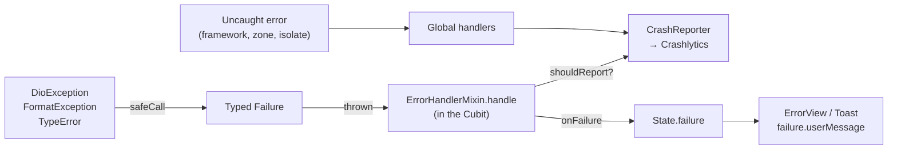

# 05 · Errors and Crashlytics

## Goal

Ensure that every error: (1) becomes a typed `Failure` with a message suitable for the user, (2) is reported to Crashlytics **exactly once**, with useful context and no personal data, and (3) never brings down the screen without a handleable error state.

The global handlers follow the official page [Handling errors in Flutter](https://docs.flutter.dev/testing/errors). Between layers, this guide throws `Failure` instead of returning `Result<T>`; the reason is in [04 · Difference from the official guide](04-networking.md#difference-from-the-official-guide).

---

## Path of an error



| Where | Does | Does not |
|---|---|---|
| `safeCall` / repository | Converts into `Failure` | Report, show a message |
| `ErrorHandlerMixin` (Cubit) | Reports (if `shouldReport`) and hands the `Failure` to the State | Decide UI text |
| UI | Shows `failure.userMessage` | Show `error.toString()` |
| Global handlers | Report whatever escaped everything else | Replace local handling |

---

## Failure hierarchy

```dart
// lib/core/errors/failure.dart
sealed class Failure implements Exception {
  const Failure({this.cause, this.stackTrace, this.debugMessage});

  final Object? cause;
  final StackTrace? stackTrace;

  /// Technical text for logs. Never shown to the user.
  final String? debugMessage;

  /// User-facing text.
  String get userMessage;

  /// Whether it should go to Crashlytics. Expected failures (no internet) do not.
  bool get shouldReport;
}

final class NetworkFailure extends Failure {
  const NetworkFailure({super.cause, super.stackTrace});
  @override
  String get userMessage => 'No internet connection. Check your network and try again.';
  @override
  bool get shouldReport => false;
}

final class TimeoutFailure extends Failure {
  const TimeoutFailure({super.cause, super.stackTrace});
  @override
  String get userMessage => 'The service took too long to respond. Try again in a moment.';
  @override
  bool get shouldReport => true;
}

final class UnauthorizedFailure extends Failure {
  const UnauthorizedFailure({super.cause, super.stackTrace});
  @override
  String get userMessage => 'Your session has expired. Sign in again to continue.';
  @override
  bool get shouldReport => false;
}

final class NotFoundFailure extends Failure {
  const NotFoundFailure({super.cause, super.stackTrace, this.backendMessage});
  final String? backendMessage;
  @override
  String get userMessage => backendMessage ?? "We couldn't find what you were looking for.";
  @override
  bool get shouldReport => false;
}

final class ValidationFailure extends Failure {
  const ValidationFailure(this.message, {this.fieldErrors = const {}});
  final String message;
  final Map<String, String> fieldErrors;
  @override
  String get userMessage => message;
  @override
  bool get shouldReport => false;
}

final class ServerFailure extends Failure {
  const ServerFailure({
    this.statusCode,
    this.backendMessage,
    super.cause,
    super.stackTrace,
  });
  final int? statusCode;
  final String? backendMessage;
  @override
  String get userMessage =>
      backendMessage ?? "We couldn't complete this right now. Try again later.";
  @override
  bool get shouldReport => statusCode == null || statusCode! >= 500;
}

final class UnexpectedFailure extends Failure {
  const UnexpectedFailure({super.cause, super.stackTrace, super.debugMessage});
  @override
  String get userMessage => 'Something went wrong. Try again.';
  @override
  bool get shouldReport => true;
}
```

### Mapping DioException

```dart
// lib/core/errors/failure_mapper.dart
abstract final class FailureMapper {
  static Failure fromDio(DioException e, StackTrace s) {
    final status = e.response?.statusCode;
    final backendMessage = _extractMessage(e.response?.data);

    return switch (e.type) {
      DioExceptionType.connectionError => NetworkFailure(cause: e, stackTrace: s),
      DioExceptionType.connectionTimeout ||
      DioExceptionType.sendTimeout ||
      DioExceptionType.receiveTimeout => TimeoutFailure(cause: e, stackTrace: s),
      DioExceptionType.unknown when e.error is SocketException =>
        NetworkFailure(cause: e, stackTrace: s),
      _ => switch (status) {
          401 || 403 => UnauthorizedFailure(cause: e, stackTrace: s),
          404 => NotFoundFailure(cause: e, stackTrace: s, backendMessage: backendMessage),
          400 || 422 => ValidationFailure(backendMessage ?? 'Check the information you entered.'),
          _ => ServerFailure(
              statusCode: status,
              backendMessage: backendMessage,
              cause: e,
              stackTrace: s,
            ),
        },
    };
  }

  /// Adapt to your backend's error format.
  static String? _extractMessage(Object? data) {
    if (data is! Map<String, dynamic>) return null;
    final messages = data['messages'] ?? data['errors'];
    if (messages is List && messages.isNotEmpty) {
      return messages.whereType<String>().join('. ');
    }
    return data['message'] as String?;
  }
}
```

### Rules

- ✅ `sealed`: a `switch` over `Failure` in the UI is exhaustive; adding a new type breaks compilation wherever it needs handling.
- ✅ Backend messages are only shown if the contract guarantees they are end-user text. When in doubt, use the default message.
- ✅ `core/errors/` does not import Flutter. Icons and colors per failure type live in extensions in the UI layer.
- ❌ `throw Exception('...')` or `throw 'text'` in any layer.
- ❌ Empty `catch (e) {}`. If the error can be ignored, comment why.

---

## CrashReporter

Abstraction over Crashlytics. Allows mocking in tests and turning it off in development.

```dart
// lib/core/errors/crash_reporter.dart
abstract interface class CrashReporter {
  void installGlobalHandlers({required bool enabled});
  Future<void> recordFailure(
    Object error,
    StackTrace? stackTrace, {
    required String operation,
    Map<String, Object> context = const {},
    bool fatal = false,
  });
  Future<void> log(String message);
  Future<void> setUserId(String? id);
}

class FirebaseCrashReporter implements CrashReporter {
  FirebaseCrashReporter([FirebaseCrashlytics? crashlytics])
      : _crashlytics = crashlytics ?? FirebaseCrashlytics.instance;

  final FirebaseCrashlytics _crashlytics;

  @override
  void installGlobalHandlers({required bool enabled}) {
    _crashlytics.setCrashlyticsCollectionEnabled(enabled);

    // Framework errors (build, layout, paint)
    FlutterError.onError = (details) {
      FlutterError.presentError(details);
      _crashlytics.recordFlutterFatalError(details);
    };

    // Uncaught asynchronous errors
    PlatformDispatcher.instance.onError = (error, stack) {
      if (error is Failure && !error.shouldReport) return true;
      _crashlytics.recordError(error, stack, fatal: true);
      return true;
    };
  }

  @override
  Future<void> recordFailure(
    Object error,
    StackTrace? stackTrace, {
    required String operation,
    Map<String, Object> context = const {},
    bool fatal = false,
  }) async {
    try {
      final cause = error is Failure ? (error.cause ?? error) : error;
      final stack = (error is Failure ? error.stackTrace : null) ?? stackTrace;

      await _crashlytics.setCustomKey('operation', operation);
      await _crashlytics.setCustomKey('failure_type', error.runtimeType.toString());
      if (cause is DioException) {
        await _crashlytics.setCustomKey('http_method', cause.requestOptions.method);
        // Path only: the query string may contain personal data
        await _crashlytics.setCustomKey('http_path', cause.requestOptions.uri.path);
        await _crashlytics.setCustomKey('http_status', cause.response?.statusCode ?? 0);
      }
      for (final e in context.entries) {
        await _crashlytics.setCustomKey('ctx_${e.key}', e.value.toString());
      }

      await _crashlytics.recordError(
        cause,
        stack,
        reason: operation,
        fatal: fatal,
      );
    } catch (_) {
      // A failure to report must never break the app.
    }
  }

  @override
  Future<void> log(String message) => _crashlytics.log(message);

  @override
  Future<void> setUserId(String? id) => _crashlytics.setUserIdentifier(id ?? '');
}
```

---

## Build error screen

When a widget fails in `build`, Flutter shows a red screen in debug and an **empty gray area** in release. Replace it with a friendly message using `ErrorWidget.builder`, configured in `MaterialApp.router`:

```dart
// lib/app.dart
MaterialApp.router(
  routerConfig: router,
  builder: (context, child) {
    if (!kDebugMode) {
      // In debug, keep the default red screen with the error details
      ErrorWidget.builder = (details) => const BuildErrorView();
    }
    return child!;
  },
);
```

```dart
// lib/shared/ui/build_error_view.dart
class BuildErrorView extends StatelessWidget {
  const BuildErrorView({super.key});

  @override
  Widget build(BuildContext context) {
    return const Material(
      child: Center(
        child: Padding(
          padding: EdgeInsets.all(AppSpacing.lg),
          child: Text(
            "This content couldn't be displayed.",
            textAlign: TextAlign.center,
          ),
        ),
      ),
    );
  }
}
```

- ✅ The error widget is simple and has no dependencies (no Cubit, no network images): it cannot fail.
- ✅ The error itself is still reported by `FlutterError.onError`; `ErrorWidget.builder` only changes what the user sees.

---

## ErrorHandlerMixin

Single place where Cubits handle errors.

```dart
// lib/core/errors/error_handler_mixin.dart
mixin ErrorHandlerMixin<S> on BlocBase<S> {
  CrashReporter get crashReporter;

  /// Ignores emit after close(): asynchronous operations may finish
  /// after the user has left the screen.
  @override
  void emit(S state) {
    if (isClosed) return;
    super.emit(state);
  }

  /// Runs [action]. On error, converts it to [Failure], reports when
  /// needed and calls [onFailure]. Returns `true` on success.
  Future<bool> handle({
    required String operation,
    required Future<void> Function() action,
    void Function(Failure failure)? onFailure,
    Map<String, Object> context = const {},
    bool fatal = false,
  }) async {
    try {
      await action();
      return true;
    } catch (error, stackTrace) {
      final failure = error is Failure
          ? error
          : UnexpectedFailure(cause: error, stackTrace: stackTrace);

      if (failure.shouldReport) {
        await crashReporter.recordFailure(
          failure,
          stackTrace,
          operation: operation,
          context: context,
          fatal: fatal,
        );
      }

      if (kDebugMode) {
        debugPrint('❌ [$operation] ${failure.runtimeType}: '
            '${failure.debugMessage ?? failure.cause}');
      }

      if (!isClosed) onFailure?.call(failure);
      return false;
    }
  }
}
```

### Rules

- ✅ `operation` in the format `<feature>.<action>` (`orders.load`, `profile.updatePhoto`). This is what groups and filters errors in the Crashlytics console.
- ✅ `context` with useful technical identifiers (`order_id`, `page`), never personal data.
- ✅ `fatal: true` only when the failure prevents use of the app's main flow (e.g. failing to restore the session at bootstrap).
- ❌ Reporting in the repository **and** in the Cubit. The same error shows up twice and skews the metrics.
- ❌ Calling the repository in a command without going through `handle(...)`. Since the guide does not use `Result<T>`, this is the rule that keeps exceptions from escaping unhandled.

In tests, use a `FakeCrashReporter` (in `testing/fakes/`) that stores the received failures in a list, to verify what was reported without Firebase.

---

## Privacy (LGPD)

Crashlytics is a third-party service. Treat everything sent there as shared data.

| ✅ May send | ❌ Never send |
|---|---|
| Opaque internal user ID (`setUserId`) | Name, email, phone, CPF/RG, address |
| Request method and **path** | URL with query string, headers, tokens, cookies |
| HTTP status, failure type, operation name | Request or response body |
| Technical IDs (`order_id`) | Free text typed by the user |
| App version, flavor, active feature flags | Precise location |

- ✅ `setUserId` on login and `setUserId(null)` on logout, in a single place (the `SessionCubit`).
- ✅ If you need to inspect a response body for debugging, do it in debug with `LogInterceptor`, not in Crashlytics.

---

## Configuration per environment

- ✅ Collection turned off in local development (`crashReportingEnabled: false` in the dev `AppConfig`), so the dashboard is not polluted with errors from whoever is coding.
- ✅ Turned on in staging and production, each in its own Firebase project (see [09](09-flavors-environments.md)).
- ✅ Symbol upload (dSYM on iOS, `--split-debug-info` + `firebase crashlytics:symbols:upload` on obfuscated builds) in the release pipeline. Without it, stack traces arrive unreadable.
