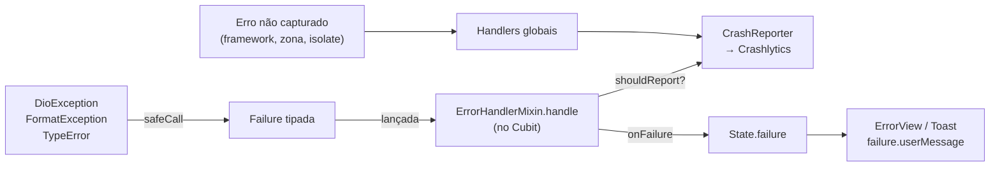

# 05 · Erros e Crashlytics

## Objetivo

Garantir que todo erro: (1) vire uma `Failure` tipada com mensagem adequada ao usuário, (2) seja reportado ao Crashlytics **uma única vez**, com contexto útil e sem dados pessoais, e (3) nunca derrube a tela sem um estado de erro tratável.

Os handlers globais seguem a página oficial [Handling errors in Flutter](https://docs.flutter.dev/testing/errors). Entre camadas, este guia lança `Failure` em vez de retornar `Result<T>`; o motivo está em [04 · Diferença em relação ao guia oficial](04-requests-rede.md#diferença-em-relação-ao-guia-oficial).

---

## Caminho de um erro



| Onde | Faz | Não faz |
|---|---|---|
| `safeCall` / repository | Converte em `Failure` | Reportar, mostrar mensagem |
| `ErrorHandlerMixin` (Cubit) | Reporta (se `shouldReport`) e entrega a `Failure` ao State | Decidir texto de UI |
| UI | Mostra `failure.userMessage` | Mostrar `error.toString()` |
| Handlers globais | Reportam o que escapou de tudo | Substituir o tratamento local |

---

## Hierarquia de Failure

```dart
// lib/core/errors/failure.dart
sealed class Failure implements Exception {
  const Failure({this.cause, this.stackTrace, this.debugMessage});

  final Object? cause;
  final StackTrace? stackTrace;

  /// Texto técnico para logs. Nunca exibido ao usuário.
  final String? debugMessage;

  /// Texto em pt_BR para o usuário.
  String get userMessage;

  /// Se deve ir para o Crashlytics. Falhas esperadas (sem internet) não vão.
  bool get shouldReport;
}

final class NetworkFailure extends Failure {
  const NetworkFailure({super.cause, super.stackTrace});
  @override
  String get userMessage => 'Sem conexão com a internet. Verifique sua rede e tente novamente.';
  @override
  bool get shouldReport => false;
}

final class TimeoutFailure extends Failure {
  const TimeoutFailure({super.cause, super.stackTrace});
  @override
  String get userMessage => 'O serviço demorou para responder. Tente novamente em instantes.';
  @override
  bool get shouldReport => true;
}

final class UnauthorizedFailure extends Failure {
  const UnauthorizedFailure({super.cause, super.stackTrace});
  @override
  String get userMessage => 'Sua sessão expirou. Entre novamente para continuar.';
  @override
  bool get shouldReport => false;
}

final class NotFoundFailure extends Failure {
  const NotFoundFailure({super.cause, super.stackTrace, this.backendMessage});
  final String? backendMessage;
  @override
  String get userMessage => backendMessage ?? 'Não encontramos o que você procurou.';
  @override
  bool get shouldReport => false;
}

final class ValidationFailure extends Failure {
  const ValidationFailure(this.message, {this.fieldErrors = const {}});
  final String message;
  final Map<String, String> fieldErrors;
  @override
  String get userMessage => message;
  @override
  bool get shouldReport => false;
}

final class ServerFailure extends Failure {
  const ServerFailure({
    this.statusCode,
    this.backendMessage,
    super.cause,
    super.stackTrace,
  });
  final int? statusCode;
  final String? backendMessage;
  @override
  String get userMessage =>
      backendMessage ?? 'Não foi possível concluir agora. Tente novamente mais tarde.';
  @override
  bool get shouldReport => statusCode == null || statusCode! >= 500;
}

final class UnexpectedFailure extends Failure {
  const UnexpectedFailure({super.cause, super.stackTrace, super.debugMessage});
  @override
  String get userMessage => 'Algo deu errado. Tente novamente.';
  @override
  bool get shouldReport => true;
}
```

### Mapeando DioException

```dart
// lib/core/errors/failure_mapper.dart
abstract final class FailureMapper {
  static Failure fromDio(DioException e, StackTrace s) {
    final status = e.response?.statusCode;
    final backendMessage = _extractMessage(e.response?.data);

    return switch (e.type) {
      DioExceptionType.connectionError => NetworkFailure(cause: e, stackTrace: s),
      DioExceptionType.connectionTimeout ||
      DioExceptionType.sendTimeout ||
      DioExceptionType.receiveTimeout => TimeoutFailure(cause: e, stackTrace: s),
      DioExceptionType.unknown when e.error is SocketException =>
        NetworkFailure(cause: e, stackTrace: s),
      _ => switch (status) {
          401 || 403 => UnauthorizedFailure(cause: e, stackTrace: s),
          404 => NotFoundFailure(cause: e, stackTrace: s, backendMessage: backendMessage),
          400 || 422 => ValidationFailure(backendMessage ?? 'Verifique os dados informados.'),
          _ => ServerFailure(
              statusCode: status,
              backendMessage: backendMessage,
              cause: e,
              stackTrace: s,
            ),
        },
    };
  }

  /// Adapte ao formato de erro do seu backend.
  static String? _extractMessage(Object? data) {
    if (data is! Map<String, dynamic>) return null;
    final messages = data['messages'] ?? data['errors'];
    if (messages is List && messages.isNotEmpty) {
      return messages.whereType<String>().join('. ');
    }
    return data['message'] as String?;
  }
}
```

### Regras

- ✅ `sealed`: um `switch` na UI sobre `Failure` é exaustivo; adicionar um tipo novo quebra a compilação onde precisa de tratamento.
- ✅ Mensagens do backend só são exibidas se o contrato garantir que são textos para o usuário final. Na dúvida, use a mensagem padrão.
- ✅ `core/errors/` não importa Flutter. Ícones e cores por tipo de falha ficam em extensions na camada de UI.
- ❌ `throw Exception('...')` ou `throw 'texto'` em qualquer camada.
- ❌ `catch (e) {}` vazio. Se o erro pode ser ignorado, comente por quê.

---

## CrashReporter

Abstração sobre o Crashlytics. Permite mock nos testes e desligar em desenvolvimento.

```dart
// lib/core/errors/crash_reporter.dart
abstract interface class CrashReporter {
  void installGlobalHandlers({required bool enabled});
  Future<void> recordFailure(
    Object error,
    StackTrace? stackTrace, {
    required String operation,
    Map<String, Object> context = const {},
    bool fatal = false,
  });
  Future<void> log(String message);
  Future<void> setUserId(String? id);
}

class FirebaseCrashReporter implements CrashReporter {
  FirebaseCrashReporter([FirebaseCrashlytics? crashlytics])
      : _crashlytics = crashlytics ?? FirebaseCrashlytics.instance;

  final FirebaseCrashlytics _crashlytics;

  @override
  void installGlobalHandlers({required bool enabled}) {
    _crashlytics.setCrashlyticsCollectionEnabled(enabled);

    // Erros do framework (build, layout, paint)
    FlutterError.onError = (details) {
      FlutterError.presentError(details);
      _crashlytics.recordFlutterFatalError(details);
    };

    // Erros assíncronos não capturados
    PlatformDispatcher.instance.onError = (error, stack) {
      if (error is Failure && !error.shouldReport) return true;
      _crashlytics.recordError(error, stack, fatal: true);
      return true;
    };
  }

  @override
  Future<void> recordFailure(
    Object error,
    StackTrace? stackTrace, {
    required String operation,
    Map<String, Object> context = const {},
    bool fatal = false,
  }) async {
    try {
      final cause = error is Failure ? (error.cause ?? error) : error;
      final stack = (error is Failure ? error.stackTrace : null) ?? stackTrace;

      await _crashlytics.setCustomKey('operation', operation);
      await _crashlytics.setCustomKey('failure_type', error.runtimeType.toString());
      if (cause is DioException) {
        await _crashlytics.setCustomKey('http_method', cause.requestOptions.method);
        // Só o path: query string pode conter dados pessoais
        await _crashlytics.setCustomKey('http_path', cause.requestOptions.uri.path);
        await _crashlytics.setCustomKey('http_status', cause.response?.statusCode ?? 0);
      }
      for (final e in context.entries) {
        await _crashlytics.setCustomKey('ctx_${e.key}', e.value.toString());
      }

      await _crashlytics.recordError(
        cause,
        stack,
        reason: operation,
        fatal: fatal,
      );
    } catch (_) {
      // Falha ao reportar nunca pode quebrar o app.
    }
  }

  @override
  Future<void> log(String message) => _crashlytics.log(message);

  @override
  Future<void> setUserId(String? id) => _crashlytics.setUserIdentifier(id ?? '');
}
```

---

## Tela de erro de build

Quando um widget falha no `build`, o Flutter mostra uma tela vermelha em debug e uma **área cinza vazia** em release. Substitua por uma mensagem amigável com `ErrorWidget.builder`, configurado no `MaterialApp.router`:

```dart
// lib/app.dart
MaterialApp.router(
  routerConfig: router,
  builder: (context, child) {
    if (!kDebugMode) {
      // Em debug, mantém a tela vermelha padrão com o detalhe do erro
      ErrorWidget.builder = (details) => const BuildErrorView();
    }
    return child!;
  },
);
```

```dart
// lib/shared/ui/build_error_view.dart
class BuildErrorView extends StatelessWidget {
  const BuildErrorView({super.key});

  @override
  Widget build(BuildContext context) {
    return const Material(
      child: Center(
        child: Padding(
          padding: EdgeInsets.all(AppSpacing.lg),
          child: Text(
            'Não foi possível exibir este conteúdo.',
            textAlign: TextAlign.center,
          ),
        ),
      ),
    );
  }
}
```

- ✅ O widget de erro é simples e sem dependências (sem Cubit, sem imagens de rede): ele não pode falhar.
- ✅ O erro em si continua sendo reportado pelo `FlutterError.onError`; o `ErrorWidget.builder` só troca o que o usuário vê.

---

## ErrorHandlerMixin

Ponto único onde Cubits tratam erros.

```dart
// lib/core/errors/error_handler_mixin.dart
mixin ErrorHandlerMixin<S> on BlocBase<S> {
  CrashReporter get crashReporter;

  /// Ignora emit depois de close(): operações assíncronas podem terminar
  /// depois que o usuário saiu da tela.
  @override
  void emit(S state) {
    if (isClosed) return;
    super.emit(state);
  }

  /// Executa [action]. Em erro, converte para [Failure], reporta quando
  /// necessário e chama [onFailure]. Retorna `true` se deu certo.
  Future<bool> handle({
    required String operation,
    required Future<void> Function() action,
    void Function(Failure failure)? onFailure,
    Map<String, Object> context = const {},
    bool fatal = false,
  }) async {
    try {
      await action();
      return true;
    } catch (error, stackTrace) {
      final failure = error is Failure
          ? error
          : UnexpectedFailure(cause: error, stackTrace: stackTrace);

      if (failure.shouldReport) {
        await crashReporter.recordFailure(
          failure,
          stackTrace,
          operation: operation,
          context: context,
          fatal: fatal,
        );
      }

      if (kDebugMode) {
        debugPrint('❌ [$operation] ${failure.runtimeType}: '
            '${failure.debugMessage ?? failure.cause}');
      }

      if (!isClosed) onFailure?.call(failure);
      return false;
    }
  }
}
```

### Regras

- ✅ `operation` no formato `<feature>.<ação>` (`orders.load`, `profile.updatePhoto`). É o que agrupa e filtra os erros no console do Crashlytics.
- ✅ `context` com identificadores técnicos úteis (`order_id`, `page`), nunca dados pessoais.
- ✅ `fatal: true` apenas quando a falha impede o uso do fluxo principal do app (ex.: não conseguir restaurar a sessão no bootstrap).
- ❌ Reportar no repository **e** no Cubit. O mesmo erro aparece duas vezes e distorce as métricas.
- ❌ Chamar o repository em um command sem passar por `handle(...)`. Como o guia não usa `Result<T>`, esta é a regra que impede exceções de escaparem sem tratamento.

Nos testes, use um `FakeCrashReporter` (em `testing/fakes/`) que guarda as falhas recebidas numa lista, para verificar o que foi reportado sem Firebase.

---

## Privacidade (LGPD)

Crashlytics é um serviço de terceiro. Trate tudo que vai para lá como dado compartilhado.

| ✅ Pode enviar | ❌ Nunca envie |
|---|---|
| ID interno opaco do usuário (`setUserId`) | Nome, e-mail, telefone, CPF/RG, endereço |
| Método e **path** da requisição | URL com query string, headers, tokens, cookies |
| Status HTTP, tipo de falha, nome da operação | Corpo da requisição ou da resposta |
| IDs técnicos (`order_id`) | Texto livre digitado pelo usuário |
| Versão do app, flavor, feature flags ativas | Localização precisa |

- ✅ `setUserId` no login e `setUserId(null)` no logout, em um único lugar (o `SessionCubit`).
- ✅ Se precisar inspecionar um corpo de resposta para depurar, faça em debug com `LogInterceptor`, não no Crashlytics.

---

## Configuração por ambiente

- ✅ Coleta desligada em desenvolvimento local (`crashReportingEnabled: false` no `AppConfig` de dev), para não poluir o painel com erros de quem está programando.
- ✅ Ligada em homologação e produção, cada uma no seu projeto Firebase (ver [09](09-flavors-ambientes.md)).
- ✅ Upload de símbolos (dSYM no iOS, `--split-debug-info` + `firebase crashlytics:symbols:upload` em builds ofuscados) no pipeline de release. Sem isso, os stack traces chegam ilegíveis.
