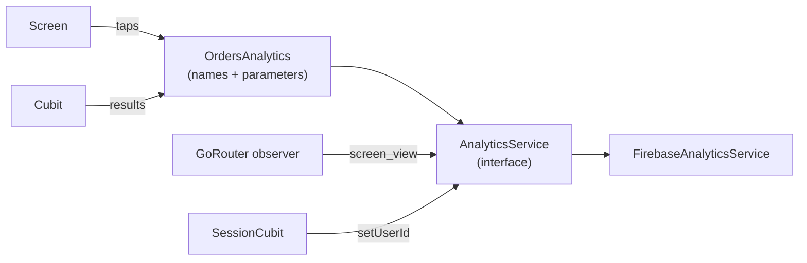

# 06 · Analytics

## Goal

Record app usage consistently, with predictable names, without repeated code in each feature and without personal data.

---

## Structure



| Piece | Responsibility |
|---|---|
| `AnalyticsService` | Single gateway to the provider. Checks whether it is enabled, normalizes parameters, swallows its own errors. |
| `<Feature>Analytics` | Event catalog for a feature: only builds the name and parameters. |
| Navigation observer | Automatic `screen_view`. |
| `SessionCubit` | `setUserId` on login and logout. |

---

## AnalyticsService

```dart
// lib/core/analytics/analytics_service.dart
abstract interface class AnalyticsService {
  Future<void> logEvent(String name, [Map<String, Object?> params = const {}]);
  Future<void> logScreenView(String screenName);
  Future<void> setUserId(String? id);
  Future<void> setUserProperty(String name, String? value);
}

class FirebaseAnalyticsService implements AnalyticsService {
  FirebaseAnalyticsService([FirebaseAnalytics? analytics])
      : _analytics = analytics ?? FirebaseAnalytics.instance;

  final FirebaseAnalytics _analytics;

  static final _validName = RegExp(r'^[a-z][a-z0-9_]{0,39}$');

  @override
  Future<void> logEvent(String name, [Map<String, Object?> params = const {}]) async {
    assert(_validName.hasMatch(name), 'Invalid event name: $name');
    try {
      await _analytics.logEvent(name: name, parameters: _normalize(params));
      if (kDebugMode) debugPrint('📊 $name $params');
    } catch (e) {
      if (kDebugMode) debugPrint('⚠️ analytics failed on $name: $e');
    }
  }

  @override
  Future<void> logScreenView(String screenName) =>
      _safe(() => _analytics.logScreenView(screenName: screenName));

  @override
  Future<void> setUserId(String? id) => _safe(() => _analytics.setUserId(id: id));

  @override
  Future<void> setUserProperty(String name, String? value) =>
      _safe(() => _analytics.setUserProperty(name: name, value: value));

  /// Firebase only accepts String and num; removes nulls, converts bool and truncates text.
  Map<String, Object> _normalize(Map<String, Object?> params) => {
        for (final e in params.entries.take(25))
          if (e.value != null)
            e.key: switch (e.value) {
              final bool b => b ? 'true' : 'false',
              final num n => n,
              final Object o => _truncate(o.toString()),
            },
      };

  String _truncate(String v) => v.length > 100 ? v.substring(0, 100) : v;

  Future<void> _safe(Future<void> Function() call) async {
    try {
      await call();
    } catch (_) {}
  }
}
```

In environments with analytics turned off (`analyticsEnabled: false` in `AppConfig`), `bootstrap.dart` uses a `NoopAnalyticsService`. In tests, use a `FakeAnalyticsService` (in `testing/fakes/`) that stores events in a list.

```dart
class NoopAnalyticsService implements AnalyticsService {
  const NoopAnalyticsService();
  @override
  Future<void> logEvent(String name, [Map<String, Object?> params = const {}]) async {}
  @override
  Future<void> logScreenView(String screenName) async {}
  @override
  Future<void> setUserId(String? id) async {}
  @override
  Future<void> setUserProperty(String name, String? value) async {}
}
```

---

## Events per feature

```dart
// features/orders/analytics/orders_analytics.dart
class OrdersAnalytics {
  const OrdersAnalytics(this._analytics);
  final AnalyticsService _analytics;

  void listLoaded({required int count}) =>
      _analytics.logEvent('orders_list_loaded', {'count': count});

  void itemTap({required String orderId, required int position}) =>
      _analytics.logEvent('orders_item_tap', {
        'order_id': orderId,
        'position': position,
      });

  void createSubmit({required bool success, String? failureType}) =>
      _analytics.logEvent('orders_create_submit', {
        'success': success,
        'failure_type': failureType,
      });
}
```

### Rules

- ✅ One class per feature, stateless and without its own singleton, created in the route along with the Cubit (`OrdersAnalytics(context.read())`) and received through the constructor.
- ✅ Methods with named, typed parameters: callers don't build a `Map` by hand.
- ✅ Don't `await` analytics in UI flows: fire and move on.
- ❌ Calling `FirebaseAnalytics.instance` outside `FirebaseAnalyticsService`.
- ❌ `try/catch` and "is it initialized?" checks in feature classes. That is the central service's responsibility.
- ❌ Adding `user_id` to every event. It is set once with `setUserId`.

---

## Naming

**Event:** `<feature>_<object>_<action>`, in `snake_case`, English or Portuguese (pick one per project and don't mix).

| ✅ Good | ❌ Bad | Problem |
|---|---|---|
| `orders_item_tap` | `clickOrder` | camelCase, no feature |
| `orders_filter_apply` | `orders_filter` | no action |
| `profile_photo_update_success` | `profile_success` | doesn't say what succeeded |
| `orders_create_submit` + `success: false` | `orders_create_error_404` | technical detail in the name; it belongs in a parameter |

**Common actions:** `view`, `tap`, `submit`, `success`, `failure`, `open`, `close`, `share`, `search`, `filter_apply`, `loaded`.

**Firebase Analytics limits:**

| Item | Limit |
|---|---|
| Event name | 40 characters, starts with a letter, only `[a-z0-9_]` |
| Parameters per event | 25 |
| Parameter name | 40 characters |
| Text value | 100 characters |
| Reserved names | Don't use the prefixes `firebase_`, `google_`, `ga_` or reserved events (`session_start`, `app_open`...) |

---

## Automatic screen view

The navigation observer records `screen_view` with the **route name**, not the path (so it doesn't create a different screen per ID).

```dart
// lib/core/navigation/analytics_route_observer.dart
class AnalyticsRouteObserver extends NavigatorObserver {
  AnalyticsRouteObserver(this._analytics);
  final AnalyticsService _analytics;

  @override
  void didPush(Route<dynamic> route, Route<dynamic>? previousRoute) => _log(route);

  @override
  void didReplace({Route<dynamic>? newRoute, Route<dynamic>? oldRoute}) {
    if (newRoute != null) _log(newRoute);
  }

  @override
  void didPop(Route<dynamic> route, Route<dynamic>? previousRoute) {
    if (previousRoute != null) _log(previousRoute);
  }

  void _log(Route<dynamic> route) {
    final name = route.settings.name;
    if (name != null && route is PageRoute) _analytics.logScreenView(name);
  }
}
```

Register it in `GoRouter(observers: [AnalyticsRouteObserver(analytics)])`, in `createRouter` (see [07](07-navigation.md#router)), and make sure every `GoRoute` has a `name` (see [07](07-navigation.md)).

`GoRouter`'s `observers` only see the root navigator. Routes inside `ShellRoute`/`StatefulShellBranch` also need the observer in the `observers` parameter of the shell or branch.

---

## Privacy

The same Crashlytics rules apply here (see [05](05-errors-crashlytics.md#privacy-lgpd)): no name, email, document, phone, address or free text typed in parameters. For searches, record `query_length` or the category, not the term.

---

## Event catalog

Each project maintains `docs/analytics-events.md` with one table per feature:

| Event | When it fires | Parameters | Source |
|---|---|---|---|
| `orders_list_loaded` | List loaded successfully | `count` (int) | `OrdersCubit.load` |
| `orders_item_tap` | Tap on an order | `order_id` (string), `position` (int) | `OrdersScreen` |

A new or changed event is only merged with the table updated in the same merge request.
