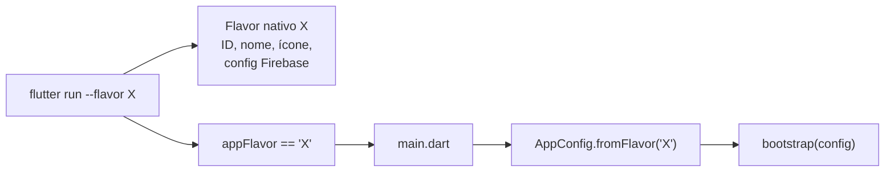

# 09 · Flavors e ambientes

## Objetivo

Permitir que o mesmo código gere apps apontando para ambientes diferentes (backend, Firebase, nome, ícone), instaláveis lado a lado no mesmo aparelho, sem `if (ambiente == ...)` espalhado pelo código.

**Cada projeto define seus próprios ambientes.** Pode ser só `dev` e `prod`, ou `dev`, `qa`, `staging`, `prod`, ou um flavor de demonstração. Este documento descreve o **mecanismo**; os nomes usados nos exemplos (`dev`, `prod`) são apenas ilustrativos.

O mecanismo segue a documentação oficial de flavors para [Android](https://docs.flutter.dev/deployment/flavors) e [iOS](https://docs.flutter.dev/deployment/flavors-ios): **um único `main.dart`**, que descobre o flavor pela constante `appFlavor`.

---

## Dois conceitos que andam juntos

| Conceito | Onde vive | O que define |
|---|---|---|
| **Flavor** | Nativo (Gradle no Android, scheme/configuration no iOS) | Application ID / Bundle ID, nome exibido, ícone, arquivo de configuração do Firebase |
| **Ambiente** | Dart (`AppConfig`) | URLs de API, chaves públicas, flags de log, coleta de Crashlytics, timeouts |

O `--flavor` escolhe a configuração nativa **e** fica disponível no Dart pela constante `appFlavor` (de `package:flutter/services.dart`). O `main.dart` usa esse valor para montar o `AppConfig` correspondente. Como existe um só entrypoint, é impossível combinar o build nativo de um ambiente com a configuração Dart de outro.



---

## Decidindo os ambientes do projeto

Antes de criar flavors, responda:

1. **Quais backends existem?** Cada backend distinto costuma justificar um ambiente.
2. **Quem instala cada build?** Desenvolvedores, QA, cliente, loja. Builds que precisam coexistir no mesmo aparelho precisam de IDs diferentes.
3. **Os dados de analytics e crash devem se misturar?** Normalmente não: um projeto Firebase por ambiente.

Regra prática: comece com o mínimo (geralmente 2) e adicione quando houver um destinatário real para o novo build.

---

## AppConfig

```dart
// lib/core/config/app_config.dart
enum AppEnvironment { dev, prod } // ajuste aos ambientes do projeto

final class AppConfig {
  const AppConfig({
    required this.environment,
    required this.appName,
    required this.apiBaseUrl,
    required this.firebaseOptions,
    this.enableHttpLogs = false,
    this.crashReportingEnabled = true,
    this.analyticsEnabled = true,
  });

  final AppEnvironment environment;
  final String appName;
  final String apiBaseUrl;
  final FirebaseOptions firebaseOptions;
  final bool enableHttpLogs;
  final bool crashReportingEnabled;
  final bool analyticsEnabled;

  bool get isProduction => environment == AppEnvironment.prod;

  factory AppConfig.dev() => AppConfig(
        environment: AppEnvironment.dev,
        appName: 'Meu App DEV',
        apiBaseUrl: const String.fromEnvironment(
          'API_BASE_URL',
          defaultValue: 'https://api-dev.exemplo.com',
        ),
        firebaseOptions: dev_firebase.DefaultFirebaseOptions.currentPlatform,
        enableHttpLogs: true,
        crashReportingEnabled: false,
        analyticsEnabled: false,
      );

  factory AppConfig.prod() => AppConfig(
        environment: AppEnvironment.prod,
        appName: 'Meu App',
        apiBaseUrl: 'https://api.exemplo.com',
        firebaseOptions: prod_firebase.DefaultFirebaseOptions.currentPlatform,
      );
}
```

```dart
// lib/core/config/app_config.dart (continuação)
  /// [flavor] é o valor de `appFlavor`, igual ao nome passado em `--flavor`.
  factory AppConfig.fromFlavor(String? flavor) => switch (flavor) {
        'dev' => AppConfig.dev(),
        'prod' => AppConfig.prod(),
        _ => throw StateError(
            'Flavor desconhecido: $flavor. Rode com --flavor ou defina default-flavor no pubspec.yaml.',
          ),
      };
```

```dart
// lib/main.dart
import 'package:flutter/services.dart';

void main() => bootstrap(AppConfig.fromFlavor(appFlavor));
```

Para `flutter run` sem `--flavor` (e o botão de play da IDE) usar o ambiente de desenvolvimento, defina o flavor padrão no `pubspec.yaml`:

```yaml
flutter:
  default-flavor: dev
```

### Regras

- ✅ O `AppConfig` é criado uma vez no `main.dart` e **passado pelo construtor** a quem precisa (`ApiClient`, `CrashReporter`...) no `bootstrap.dart`.
- ✅ Diferenças entre ambientes são **valores** no `AppConfig` (`enableHttpLogs`, `crashReportingEnabled`), não `if (environment == dev)` no código.
- ✅ `main.dart` mínimo: uma linha chamando `bootstrap`.
- ✅ `appFlavor` lido **só** no `main.dart`. O resto do app conhece apenas o `AppConfig`.
- ❌ `const bool isProd = ...` global, ou checagem de `kReleaseMode` para decidir ambiente. Build de release de homologação é release, mas não é produção.
- ❌ Ler o ambiente de variável global estática em qualquer camada.

---

## Segredos e valores por máquina

- ✅ O que é **público por natureza** (URL da API, `FirebaseOptions`) pode ficar no código.
- ✅ O que é **sensível ou varia por máquina/pipeline** vem de `--dart-define-from-file`:

```bash
flutter run --flavor dev --dart-define-from-file=env/dev.json
```

`env/dev.json`, fora do controle de versão (`.gitignore`):

```json
{ "API_BASE_URL": "http://192.168.0.10:8080", "MAPS_API_KEY": "..." }
```

- ✅ Versione um `env/example.json` com as chaves e valores falsos.
- ✅ No CI, gere o arquivo a partir das variáveis secretas do pipeline.
- ❌ Chaves privadas, client secrets ou senhas no app, mesmo via `dart-define`: tudo que está no binário pode ser extraído. Segredo de verdade fica no backend.

---

## Firebase por ambiente

Um projeto Firebase por ambiente (ou, no mínimo, um para produção e um para o resto).

```bash
flutterfire configure \
  --project=meu-app-dev \
  --out=lib/core/firebase/firebase_options_dev.dart \
  --ios-bundle-id=br.com.exemplo.app.dev \
  --android-package-name=br.com.exemplo.app.dev
```

Repita para cada ambiente e importe com prefixo no `AppConfig`:

```dart
import 'package:my_app/core/firebase/firebase_options_dev.dart' as dev_firebase;
import 'package:my_app/core/firebase/firebase_options_prod.dart' as prod_firebase;
```

Os arquivos nativos ficam por flavor:

```
android/app/src/<flavor>/google-services.json
ios/config/<flavor>/GoogleService-Info.plist   # copiado por script na build (ver iOS)
```

---

## Android

```kotlin
// android/app/build.gradle.kts
android {
    flavorDimensions += "environment"
    productFlavors {
        create("dev") {
            dimension = "environment"
            applicationIdSuffix = ".dev"
        }
        create("prod") {
            dimension = "environment"
        }
    }
}
```

O nome exibido vem de um `strings.xml` por flavor:

```xml
<!-- android/app/src/dev/res/values/strings.xml -->
<resources>
    <string name="app_name">Meu App DEV</string>
</resources>
```

```xml
<!-- android/app/src/prod/res/values/strings.xml -->
<resources>
    <string name="app_name">Meu App</string>
</resources>
```

- ✅ `applicationIdSuffix` para que os flavors coexistam no aparelho.
- ✅ `android:label="@string/app_name"` no `AndroidManifest.xml`.
- ❌ `resValue("string", "app_name", ...)` no Gradle. Com o Android Gradle Plugin 9+, o build falha por padrão; a documentação oficial recomenda `strings.xml` nos source sets do flavor.
- ❌ `abiFilters` dentro de `productFlavors`. Se precisar, configure em `defaultConfig`.
- ✅ Ícones por flavor em `android/app/src/<flavor>/res/mipmap-*` (gerados com `flutter_launcher_icons` usando um arquivo de configuração por flavor).

---

## iOS

O iOS não tem flavors: o equivalente é **uma build configuration por flavor e modo** + **um scheme por flavor**.

1. Em *Project → Info → Configurations*, duplique para ter `Debug-dev`, `Release-dev`, `Profile-dev`, `Debug-prod`, `Release-prod`, `Profile-prod`. O sufixo precisa ser **exatamente** o nome do flavor usado no `--flavor`, em minúsculas.
2. Crie um scheme por flavor (`dev`, `prod`), marcado como *Shared*, com Run/Test/Analyze em `Debug-<flavor>`, Profile em `Profile-<flavor>` e Archive em `Release-<flavor>`. O nome do scheme é o valor que chega em `appFlavor`.
3. Para cada configuration, defina em *Build Settings*:
   - `PRODUCT_BUNDLE_IDENTIFIER` (ex.: `br.com.exemplo.app.dev`)
   - `APP_DISPLAY_NAME` (variável usada em `CFBundleDisplayName` do `Info.plist`)
   - `ASSETCATALOG_COMPILER_APPICON_NAME` (ex.: `AppIcon-dev`)
4. Firebase: a documentação oficial de flavors não cobre o `GoogleService-Info.plist`. Use uma *Run Script Phase* posicionada **depois** de *Copy Bundle Resources* para copiar o arquivo do flavor (e não adicione esses plists ao target, para o Xcode não copiá-los sozinho):

```bash
FLAVOR="${CONFIGURATION##*-}"
cp "${PROJECT_DIR}/config/${FLAVOR}/GoogleService-Info.plist" \
   "${BUILT_PRODUCTS_DIR}/${PRODUCT_NAME}.app/GoogleService-Info.plist"
```

5. Adicione as configurations novas ao bloco `project` do `Podfile` e rode `pod install`:

```ruby
project 'Runner', {
  'Debug-dev' => :debug, 'Profile-dev' => :release, 'Release-dev' => :release,
  'Debug-prod' => :debug, 'Profile-prod' => :release, 'Release-prod' => :release,
}
```

---

## Executando e gerando builds

```bash
flutter run --flavor dev
```

```bash
flutter build appbundle --release --flavor prod --obfuscate --split-debug-info=build/symbols
```

```bash
flutter build ipa --release --flavor prod --obfuscate --split-debug-info=build/symbols
```

Documente os comandos de cada flavor no `README.md` do projeto e, se usar VS Code ou Android Studio, versione as configurações de execução (`.vscode/launch.json` / `.run/`).

---

## Checklist: adicionar um ambiente novo

- [ ] Valor novo no `enum AppEnvironment` e factory `AppConfig.<nome>()`
- [ ] Caso novo no `switch` de `AppConfig.fromFlavor`
- [ ] Projeto Firebase + `flutterfire configure` gerando `firebase_options_<nome>.dart`
- [ ] Android: `productFlavors` + `src/<nome>/res/values/strings.xml` + `src/<nome>/google-services.json` + ícone
- [ ] iOS: configurations `Debug/Release/Profile-<nome>`, scheme compartilhado, `Podfile`, bundle id, ícone, `config/<nome>/GoogleService-Info.plist`
- [ ] Chave APNs no projeto Firebase novo (push no iOS)
- [ ] `env/<nome>.json` (se houver `dart-define`) e variáveis no CI
- [ ] Comandos documentados no README do projeto
