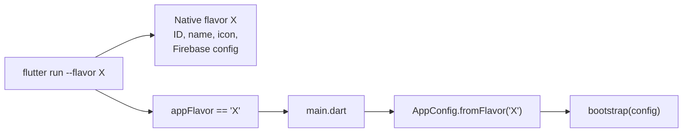

# 09 · Flavors and environments

## Goal

Allow the same code to produce apps pointing to different environments (backend, Firebase, name, icon), installable side by side on the same device, without `if (environment == ...)` scattered across the code.

**Each project defines its own environments.** It can be just `dev` and `prod`, or `dev`, `qa`, `staging`, `prod`, or a demo flavor. This document describes the **mechanism**; the names used in the examples (`dev`, `prod`) are illustrative only.

The mechanism follows the official flavor documentation for [Android](https://docs.flutter.dev/deployment/flavors) and [iOS](https://docs.flutter.dev/deployment/flavors-ios): **a single `main.dart`**, which discovers the flavor through the `appFlavor` constant.

---

## Two concepts that go together

| Concept | Where it lives | What it defines |
|---|---|---|
| **Flavor** | Native (Gradle on Android, scheme/configuration on iOS) | Application ID / Bundle ID, display name, icon, Firebase configuration file |
| **Environment** | Dart (`AppConfig`) | API URLs, public keys, log flags, Crashlytics collection, timeouts |

`--flavor` picks the native configuration **and** is available in Dart through the `appFlavor` constant (from `package:flutter/services.dart`). `main.dart` uses this value to build the matching `AppConfig`. Since there is a single entrypoint, it's impossible to combine the native build of one environment with the Dart configuration of another.



---

## Deciding the project's environments

Before creating flavors, answer:

1. **Which backends exist?** Each distinct backend usually justifies an environment.
2. **Who installs each build?** Developers, QA, client, store. Builds that need to coexist on the same device need different IDs.
3. **Should analytics and crash data be mixed?** Usually not: one Firebase project per environment.

Rule of thumb: start with the minimum (usually 2) and add one when there is a real recipient for the new build.

---

## AppConfig

```dart
// lib/core/config/app_config.dart
enum AppEnvironment { dev, prod } // adjust to the project's environments

final class AppConfig {
  const AppConfig({
    required this.environment,
    required this.appName,
    required this.apiBaseUrl,
    required this.firebaseOptions,
    this.enableHttpLogs = false,
    this.crashReportingEnabled = true,
    this.analyticsEnabled = true,
  });

  final AppEnvironment environment;
  final String appName;
  final String apiBaseUrl;
  final FirebaseOptions firebaseOptions;
  final bool enableHttpLogs;
  final bool crashReportingEnabled;
  final bool analyticsEnabled;

  bool get isProduction => environment == AppEnvironment.prod;

  factory AppConfig.dev() => AppConfig(
        environment: AppEnvironment.dev,
        appName: 'My App DEV',
        apiBaseUrl: const String.fromEnvironment(
          'API_BASE_URL',
          defaultValue: 'https://api-dev.example.com',
        ),
        firebaseOptions: dev_firebase.DefaultFirebaseOptions.currentPlatform,
        enableHttpLogs: true,
        crashReportingEnabled: false,
        analyticsEnabled: false,
      );

  factory AppConfig.prod() => AppConfig(
        environment: AppEnvironment.prod,
        appName: 'My App',
        apiBaseUrl: 'https://api.example.com',
        firebaseOptions: prod_firebase.DefaultFirebaseOptions.currentPlatform,
      );
}
```

```dart
// lib/core/config/app_config.dart (continued)
  /// [flavor] is the value of `appFlavor`, equal to the name passed in `--flavor`.
  factory AppConfig.fromFlavor(String? flavor) => switch (flavor) {
        'dev' => AppConfig.dev(),
        'prod' => AppConfig.prod(),
        _ => throw StateError(
            'Unknown flavor: $flavor. Run with --flavor or set default-flavor in pubspec.yaml.',
          ),
      };
```

```dart
// lib/main.dart
import 'package:flutter/services.dart';

void main() => bootstrap(AppConfig.fromFlavor(appFlavor));
```

For `flutter run` without `--flavor` (and the IDE's play button) to use the development environment, set the default flavor in `pubspec.yaml`:

```yaml
flutter:
  default-flavor: dev
```

### Rules

- ✅ `AppConfig` is created once in `main.dart` and **passed through the constructor** to whoever needs it (`ApiClient`, `CrashReporter`...) in `bootstrap.dart`.
- ✅ Differences between environments are **values** in `AppConfig` (`enableHttpLogs`, `crashReportingEnabled`), not `if (environment == dev)` in the code.
- ✅ Minimal `main.dart`: one line calling `bootstrap`.
- ✅ `appFlavor` read **only** in `main.dart`. The rest of the app only knows `AppConfig`.
- ❌ A global `const bool isProd = ...`, or checking `kReleaseMode` to decide the environment. A staging release build is a release, but it isn't production.
- ❌ Reading the environment from a static global variable in any layer.

---

## Secrets and per-machine values

- ✅ What is **public by nature** (API URL, `FirebaseOptions`) can stay in the code.
- ✅ What is **sensitive or varies per machine/pipeline** comes from `--dart-define-from-file`:

```bash
flutter run --flavor dev --dart-define-from-file=env/dev.json
```

`env/dev.json`, kept out of version control (`.gitignore`):

```json
{ "API_BASE_URL": "http://192.168.0.10:8080", "MAPS_API_KEY": "..." }
```

- ✅ Commit an `env/example.json` with the keys and fake values.
- ✅ In CI, generate the file from the pipeline's secret variables.
- ❌ Private keys, client secrets or passwords in the app, even via `dart-define`: everything in the binary can be extracted. Real secrets stay on the backend.

---

## Firebase per environment

One Firebase project per environment (or, at minimum, one for production and one for everything else).

```bash
flutterfire configure \
  --project=my-app-dev \
  --out=lib/core/firebase/firebase_options_dev.dart \
  --ios-bundle-id=com.example.app.dev \
  --android-package-name=com.example.app.dev
```

Repeat for each environment and import with a prefix in `AppConfig`:

```dart
import 'package:my_app/core/firebase/firebase_options_dev.dart' as dev_firebase;
import 'package:my_app/core/firebase/firebase_options_prod.dart' as prod_firebase;
```

The native files are per flavor:

```
android/app/src/<flavor>/google-services.json
ios/config/<flavor>/GoogleService-Info.plist   # copied by a script during the build (see iOS)
```

---

## Android

```kotlin
// android/app/build.gradle.kts
android {
    flavorDimensions += "environment"
    productFlavors {
        create("dev") {
            dimension = "environment"
            applicationIdSuffix = ".dev"
        }
        create("prod") {
            dimension = "environment"
        }
    }
}
```

The display name comes from a per-flavor `strings.xml`:

```xml
<!-- android/app/src/dev/res/values/strings.xml -->
<resources>
    <string name="app_name">My App DEV</string>
</resources>
```

```xml
<!-- android/app/src/prod/res/values/strings.xml -->
<resources>
    <string name="app_name">My App</string>
</resources>
```

- ✅ `applicationIdSuffix` so the flavors coexist on the device.
- ✅ `android:label="@string/app_name"` in `AndroidManifest.xml`.
- ❌ `resValue("string", "app_name", ...)` in Gradle. With Android Gradle Plugin 9+, the build fails by default; the official documentation recommends `strings.xml` in the flavor's source sets.
- ❌ `abiFilters` inside `productFlavors`. If needed, configure it in `defaultConfig`.
- ✅ Per-flavor icons in `android/app/src/<flavor>/res/mipmap-*` (generated with `flutter_launcher_icons` using one configuration file per flavor).

---

## iOS

iOS has no flavors: the equivalent is **one build configuration per flavor and mode** + **one scheme per flavor**.

1. In *Project → Info → Configurations*, duplicate to get `Debug-dev`, `Release-dev`, `Profile-dev`, `Debug-prod`, `Release-prod`, `Profile-prod`. The suffix must be **exactly** the flavor name used in `--flavor`, in lowercase.
2. Create one scheme per flavor (`dev`, `prod`), marked as *Shared*, with Run/Test/Analyze on `Debug-<flavor>`, Profile on `Profile-<flavor>` and Archive on `Release-<flavor>`. The scheme name is the value that arrives in `appFlavor`.
3. For each configuration, set in *Build Settings*:
   - `PRODUCT_BUNDLE_IDENTIFIER` (e.g. `com.example.app.dev`)
   - `APP_DISPLAY_NAME` (variable used in the `Info.plist`'s `CFBundleDisplayName`)
   - `ASSETCATALOG_COMPILER_APPICON_NAME` (e.g. `AppIcon-dev`)
4. Firebase: the official flavor documentation doesn't cover `GoogleService-Info.plist`. Use a *Run Script Phase* placed **after** *Copy Bundle Resources* to copy the flavor's file (and don't add these plists to the target, so Xcode doesn't copy them on its own):

```bash
FLAVOR="${CONFIGURATION##*-}"
cp "${PROJECT_DIR}/config/${FLAVOR}/GoogleService-Info.plist" \
   "${BUILT_PRODUCTS_DIR}/${PRODUCT_NAME}.app/GoogleService-Info.plist"
```

5. Add the new configurations to the `project` block of the `Podfile` and run `pod install`:

```ruby
project 'Runner', {
  'Debug-dev' => :debug, 'Profile-dev' => :release, 'Release-dev' => :release,
  'Debug-prod' => :debug, 'Profile-prod' => :release, 'Release-prod' => :release,
}
```

---

## Running and building

```bash
flutter run --flavor dev
```

```bash
flutter build appbundle --release --flavor prod --obfuscate --split-debug-info=build/symbols
```

```bash
flutter build ipa --release --flavor prod --obfuscate --split-debug-info=build/symbols
```

Document each flavor's commands in the project's `README.md` and, if you use VS Code or Android Studio, commit the run configurations (`.vscode/launch.json` / `.run/`).

---

## Checklist: adding a new environment

- [ ] New value in `enum AppEnvironment` and factory `AppConfig.<name>()`
- [ ] New case in the `AppConfig.fromFlavor` `switch`
- [ ] Firebase project + `flutterfire configure` generating `firebase_options_<name>.dart`
- [ ] Android: `productFlavors` + `src/<name>/res/values/strings.xml` + `src/<name>/google-services.json` + icon
- [ ] iOS: `Debug/Release/Profile-<name>` configurations, shared scheme, `Podfile`, bundle id, icon, `config/<name>/GoogleService-Info.plist`
- [ ] APNs key in the new Firebase project (push on iOS)
- [ ] `env/<name>.json` (if there is a `dart-define`) and CI variables
- [ ] Commands documented in the project's README
